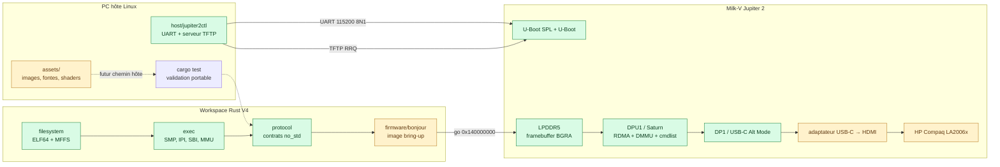
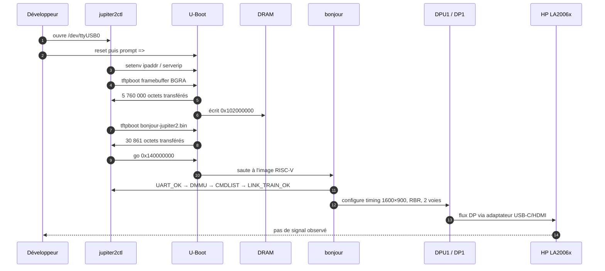
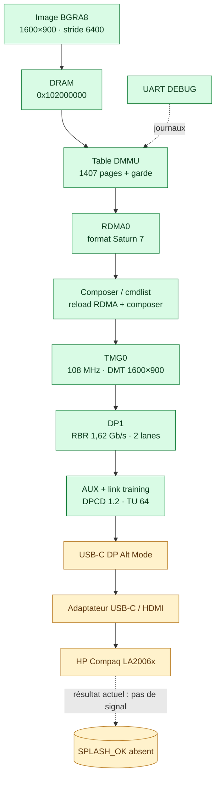
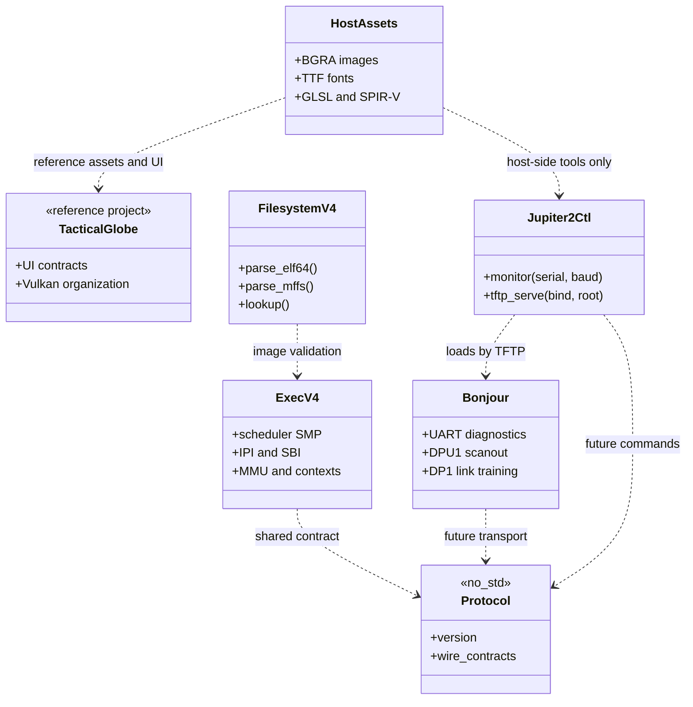
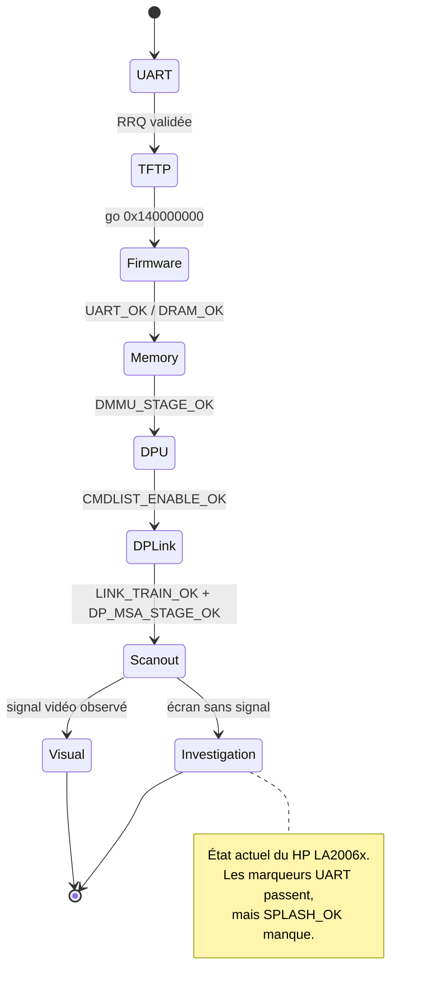

# Architecture V4 — premier jalon

Ce document décrit les frontières du projet, le chemin de bring-up de la
Jupiter 2 et la trajectoire vers l'interface V4. Les diagrammes Mermaid sont
volontairement centrés sur les contrats et les flux observables ; ils ne
déclarent pas opérationnels les composants encore en cours de portage.

## Carte du projet



La chaîne UART/TFTP, la mémoire, le firmware `bonjour`, les registres DPU/DP,
le link training et les marqueurs de scanout sont observés sur la carte. Le
moniteur reste sans signal avec la chaîne USB-C vers HDMI ; le jalon
`SPLASH_OK` n'est donc pas déclaré.

## Flux de démarrage et de validation



## Chemin vidéo matériel



## Frontières des composants



## États du bring-up



## Décision de séparation

V4 ne copie pas le workspace V3. V3 reste la source de contrats et de
validation QEMU/Venus ; V4 commence avec une surface réduite pour pouvoir
valider la carte réelle avant de réintroduire l'UI et le rendu.

```text
host/jupiter2ctl ── UART DEBUG ── Milk-V Jupiter 2
       │
       └──────────── TFTP RRQ ─── bootloader de la carte

assets ─── ressources UI / shaders ─── outil hôte, après validation Vulkan

protocol (no_std)
       │
firmware/bonjour ─── image de test, après validation du profil de boot

exec-v4 ─── scheduler SMP / contextes / IPI / SBI / MMU
    │
    └── filesystem-v4 (validation ELF/MFFS)
```

La liaison électrique UART DEBUG est en **logique 1,8 V**. GND est commun et
TXD/RXD sont croisés ; un adaptateur 3,3 V ne doit pas être branché directement.
La couche hôte configure ensuite l'UART en 8N1 sans contrôle de flux, comme la
liaison DEBUG déjà validée. Le serveur TFTP sert uniquement des noms relatifs sous sa
racine et implémente le transfert `octet` par blocs de 512 octets avec ACK et
retransmissions bornées.

## Preuve de démarrage obtenue

La liaison UART a été validée avec un FTDI FT232R sur `/dev/ttyUSB0`, en
logique 1,8 V. Le boot observé est celui d'une carte SpacemiT K3 Pico ITX :
U-Boot SPL 2022.10, U-Boot 2022.10, 16 GiB de LPDDR5, puis Bianbu 4.0.7 avec
Linux 6.18.3-generic sur UFS. La partition `/boot` est `/dev/sda2` et contient
le noyau, l'initrd et le DTB `spacemit/6.18.3-generic/k3-pico-itx.dtb`.

Pendant la phase d'inspection, le point d'arrêt était volontairement situé
avant Linux. Comme la touche d'interruption U-Boot n'avait pas été identifiée,
`/boot/env_k3.txt` contenait
temporairement `bootdelay=5` et `bootcmd=echo V4_BOOT_HALTED`. Cette méthode
produit le prompt U-Boot `=>` et conserve les copies
`env_k3.txt.boot_bak` et `env_k3.txt.bootdelay_bak`. Elle permet d'inspecter
U-Boot et de préparer le réseau sans modifier encore l'image V4.

Cette preuve établit la chaîne console, bootloader, mémoire, stockage et
réseau. U-Boot a reçu `jupiter2-test.bin` depuis `192.168.1.131` avec
l'adresse Jupiter `192.168.1.132`, à l'adresse mémoire `0x102000000`. Elle ne
valide pas encore le protocole V4 ni l'exécution de `firmware/bonjour`.

Le jalon suivant a maintenant validé l'exécution de `firmware/bonjour` : le
splash BGRA est chargé à `0x102000000`, le firmware à `0x140000000`, et les
jalons `UART_OK`, `DRAM_OK` et `SPLASH_RAM_READ` arrivent sur la console. Le
scanout DPU/DisplayPort reste séparé de cette preuve d'exécution.

La sonde suivante a validé la lecture MMIO de la sortie utilisée par le
Pico-ITX : DPU1 à `0xC0440000` et DP1 à `0xCAC88000`. Elle renvoie la
signature Saturn `0x08040030`. Le futur backend d'affichage suivra le pilote
Linux dans l'ordre power-domain → clocks/resets → DMMU/RDMA/cmdlist → DP AUX
et timings ; l'adresse du framebuffer seule ne constitue pas une séquence de
scanout.

Les assets importés de V3 restent dans le chemin hôte. Les fontes et modules
SPIR-V ne sont pas embarqués dans `firmware/bonjour` et ne sont pas servis par
TFTP. Le seul fichier temporairement copié dans `tftp-root` est le splash BGRA,
pour le test de framebuffer décrit ci-dessous. L'utilisation UI complète
attend la validation du pilote RGX/Vulkan et du contrat de ressources.

Le premier jalon graphique V4 suit un chemin plus court : UART pour le journal,
TFTP pour déposer le framebuffer BGRA en DRAM, puis DPU/DisplayPort pour le
scanout. RGX et les shaders restent hors de ce jalon. Le framebuffer
`1920×1080×4` occupe `8 294 400` octets avec un stride de `7680`.

Le firmware a validé la préparation du timing Saturn DP1 à `DPU1 + 0x51200`
pour 1920×1080@60, sans activer `fm_timing_en`. Le prochain point matériel est
le plane RDMA0 en BGRA8888, suivi du mapping DMMU et de la cmdlist avant le
link training DP.

Le plane RDMA0 est maintenant préparé et relu sur la carte : adresse
`0x102000000`, stride `7680`, format Saturn `7` (`BGRA8888`) et surface
1920×1080. La couche composer reste désactivée tant que le DMMU et la cmdlist
ne sont pas portés.

La séquence matérielle est volontairement progressive :

```text
UART log → DRAM accessible → image TFTP en mémoire
         → DPU plane brut → timings DisplayPort → splash visible
```

Le chargement en mémoire est testable dès maintenant avec l'adresse
`0x102000000`, déjà validée par U-Boot. La présentation bare-metal attend la
validation des clocks, resets, power domains, mapping DMMU/IOMMU et registres
du DPU. Aucun accès registre graphique n'est ajouté sur la seule base des
adresses documentées.

## Suite de portage

1. construire une image V4 connue et la déposer dans `tftp-root/` ;
2. vérifier son chargement TFTP sans l'exécuter ;
3. intégrer le point d'entrée et le linker Jupiter 2 dans `firmware/bonjour` ;
4. ajouter le transport de commandes V4 sur UART ;
5. porter les contrats `RenderPlan`, surfaces et z-order de V3 ;
6. intégrer egui/Vulkan de TacticalGlobe dans l'outil de validation ;
7. seulement ensuite ouvrir le backend RGX/Vulkan puis V2D/DPU.

Le backend matériel ne sera marqué opérationnel qu'après validation des
registres, DMA, caches, IRQ et fences sur la carte.
