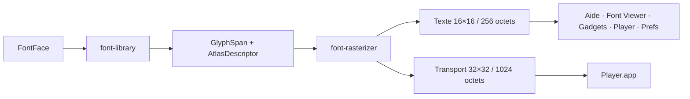

# Histoire d'Exec Modernisé

Ce fichier rassemble l'histoire technique du projet et conserve l'archive des
sessions V1. Le projet s'inspire explicitement de l'organisation d'AmigaOS :
Exec fournit le noyau et l'ordonnancement, les Libraries portent les contrats
système, les Devices isolent le matériel, et les applications restent clientes
de ces interfaces.

Pour le contexte historique d'AmigaOS, voir
[`docs/AMIGAOS_HISTORY.md`](docs/AMIGAOS_HISTORY.md). Ce chapitre reprend le
travail documentaire de V2 sur l'Amiga 1000, Exec, Intuition, Graphics,
Workbench, les Devices et l'héritage retenu pour Exec Modernisé.

L'état des lieux comparatif des systèmes, repris de V2, est conservé dans
[`docs/ETAT_DES_LIEUX_OS.md`](docs/ETAT_DES_LIEUX_OS.md). Il explique les
choix de conception face à Linux, macOS, Android, iOS, Windows et AmigaOS ; il
reste un document historique, tandis que `PROGRESS.md` décrit l'état courant.

## Chronologie du projet

### Héritage AmigaOS — années 1980 et 1990

AmigaOS a popularisé une organisation légère et modulaire autour d'Exec,
d'Intuition, de Graphics, de Workbench, des Libraries et des Devices. Sa force
venait de la combinaison d'un noyau réactif, d'une communication explicite et
d'une séparation claire entre politique applicative et accès matériel.

Exec Modernisé reprend cette idée comme contrat d'architecture. Le projet
remplace les contraintes matérielles historiques par Rust, RISC-V, mémoire
protégée, SMP et GPU moderne, tout en conservant les frontières conceptuelles
qui rendent le système lisible et extensible.

### V1 — fondation Exec, Workbench et Venus

La V1 a établi le modèle de système multimédia inspiré d'AmigaOS :

- Exec, les tâches, processus légers, signaux, ports de messages et IPC ;
- les façades Libraries et les Devices spécialisés ;
- Intuition pour les Screens, Windows, focus et événements ;
- GadTools et Layout pour les widgets et la géométrie ;
- Graphics et Venus pour une composition GPU-only ;
- ExecFS/MFFS pour charger des applications et leurs ressources.

L'archive de sessions conservée plus bas documente les validations QEMU/Venus,
les corrections d'ABI LVO, le rendu du curseur, UILab, GadTools, Player,
RoomAnalyzer, l'audio et le pipeline de surfaces.

### V2 — contrats portables et bring-up RISC-V

La V2 a séparé les contrats portables du runtime et a documenté le passage vers
RISC-V : ELF64, MFFS, Sv39, PMP, scheduler, multi-hart, IPC et Devices. Le
chapitre AmigaOS a explicité les choix d'héritage : préserver Exec, les
Libraries et les Devices, puis remplacer les dépendances implicites par des
contrats testables.

Le chapitre historique précise également la place de `dos.library`, le rôle
des handlers de volume et la différence entre le FFS historique, ExecFS et le
catalogue MFFS V1 utilisé par le chargement ELF de V4.

Il documente maintenant aussi l'interruption verticale VERTB, les cadences PAL
50 Hz et NTSC 59,94/60 Hz, ainsi que leur équivalent moderne VSync/scanout
DisplayPort pour la Jupiter 2.

Le bring-up QEMU a servi de banc reproductible avant l'arrivée du matériel
Jupiter 2. Les premiers diagrammes et règles de propriété ont aussi fixé la
séparation entre application, Library, Device et backend GPU.

### V3 — architecture UI/GPU et TacticalGlobe

La V3 a consolidé les contrats d'interface : SceneTree, Intuition, GadTools,
Layout, Graphics, fonts, cursor, Devices et backend Venus. Elle a aussi porté
les principes nécessaires au futur rendu 3D de TacticalGlobe : caméra,
ressources, surfaces, commandes GPU, shaders et séparation entre préparation
CPU et composition matérielle.

V3 reste une source de contrats et de résultats de validation. V4 ne recopie
pas son workspace ; elle réintroduit progressivement les interfaces après
validation de la carte réelle.

### V4 — Jupiter 2 et validation matérielle

V4 commence par le chemin le plus court vers le matériel :

1. UART DEBUG 1,8 V pour les journaux ;
2. TFTP pour déposer une image et un framebuffer en DRAM ;
3. firmware `bonjour` bare-metal RISC-V ;
4. DPU1/Saturn, DMMU, RDMA et cmdlist ;
5. DP1, AUX et link training ;
6. USB-C DP Alt Mode et adaptation HDMI.

Le firmware est maintenant transféré et exécuté sur la Milk-V Jupiter 2. Les
marqueurs `DMMU_STAGE_OK`, `CMDLIST_ENABLE_OK`, `LINK_TRAIN_OK`,
`DP_MSA_STAGE_OK`, `SCANOUT_STAGE_OK` et `MMIO_PROBE_OK` sont confirmés sur
l'UART. Le HP Compaq LA2006x reste sans signal via l'adaptateur USB-C/HDMI,
si bien que `SPLASH_OK` reste ouvert.

La procédure et les traces détaillées sont dans
[`JUPITER2_BRINGUP.md`](JUPITER2_BRINGUP.md), tandis que l'état synthétique est
tenue dans [`PROGRESS.md`](PROGRESS.md).

## Principes conservés

- les applications demandent un service à une Library ou à un Device ;
- chaque ressource possède un propriétaire explicite ;
- les contrats portables restent séparés des handles matériels ;
- les preuves de compilation, QEMU et carte réelle sont distinguées ;
- le chemin GPU reste séparé de la politique UI ;
- toute étape matérielle reçoit un marqueur UART et une trace documentaire.

## Archive V1

La suite de ce fichier conserve les comptes rendus historiques de V1. Les
mentions de QEMU, Venus, Workbench, Player, GadTools et audio décrivent les
étapes de cette génération ; elles servent de mémoire technique et de source
pour les contrats V2/V3/V4.

# Historique — Exec Modernisé

## Session du 17 août 2026 — curseur figé après le premier mouvement

Le curseur rouge au centre était bien composé par Venus, mais le transport
VirtIO-tablet ne livrait qu'un premier paquet : les descripteurs remis dans la
queue n'étaient pas suivis d'une écriture `QUEUE_NOTIFY`. Le driver réarme
désormais la queue et publie les coordonnées dès `ABS_X`/`ABS_Y`, en plus du
`SYN_REPORT` habituel.

Le compteur de demandes Desktop a également été corrigé. Une invalidation
arrivée pendant une frame Venus en vol n'est plus confondue avec la frame déjà
soumise ; elle est conservée pour la composition suivante. Le curseur reste
GPU-only et `cursorq` demeure désactivé.

## Session du 17 août 2026 — vrai render-pass curseur-only

Le curseur n'est plus enregistré dans le render-pass qui compose les
rectangles, le chrome et les surfaces GadTools. `vulkan_draw_cursor` termine
le pass desktop, ouvre une seconde invocation Venus en `LOAD/STORE` sur le
framebuffer courant, puis lie exclusivement `PCI_VULKAN_CURSOR_PIPELINE` et
dessine le quad procédural. Le curseur reste ainsi le dernier rendu GPU sans
écriture CPU et sans réactiver `cursorq`.

Cette étape sépare le pass Vulkan ; la séparation ultérieure d'une surface
desktop persistante sans curseur et d'un command buffer dédié reste distincte.

## Session du 17 août 2026 — correction de la table LVO Graphics/Venus

Pendant le diagnostic de la fenêtre UILab vide et de la rémanence, les traces
ont montré que GadTools envoyait à `FillRectGpu` des rectangles `1280×720`.
L'assembleur de `graphics.library` ne contenait plus les symboles des LVO 9,
11, 12, 13 et 14 alors que l'image réservait bien leurs cases. Les offsets
vides étaient convertis silencieusement en zéro par `build-execfs.sh` ; les
appels indirects de GadTools ne respectaient donc plus l'ABI.

Les wrappers GPU manquants ont été rétablis et le script de construction
refuse maintenant toute entrée Graphics absente. Une image légère UILab a
ensuite confirmé les bounds réels (`960×560`, puis `52×52`, `52×2`) et un
`Present surface` accepté. L'instrumentation temporaire a été retirée. Le
curseur reste composé par Venus en dernier pass ; cette correction ne réunit
pas le curseur avec le rendu des fenêtres.

Une seconde disparition venait du compositeur : le front GPU d'une fenêtre
était considéré comme déjà rendu même lorsqu'il n'appartenait plus à la frame
Venus active. Le client était donc sauté sans blit de restauration. Le chemin
différencie maintenant surface déjà enregistrée (pas de double rendu) et front
persistant (blit GPU avant le chrome). Le pass curseur-only reste à réaliser
à ce stade du diagnostic pour éviter qu'un mouvement de souris ne recomposite
tout le bureau.

Le pass curseur-only incrémental a ensuite été activé : l'ancienne et la
nouvelle boîte `28×28` sont fusionnées dans le dommage, les couches concernées
sont restaurées avec clipping, puis le shader curseur est dessiné en dernier.
Un mouvement de souris ne demande plus de dommage `1920×1080`. Une ressource
desktop dédiée et un command buffer séparé restent une optimisation ultérieure,
pas une condition de correction visuelle.

## Session du 17 août 2026 — reprise UILab

Après la validation du move/resize de `UILab.app`, l'application a été
transformée en banc GadTools minimal. La scène couvre `VBox`, `HBox`,
boutons, slider, labels et sept états de curseur. Les cases sont exclusives,
le focus est visible en jaune et le style du curseur passe par l'ABI GPU.

Le correctif de library ajoute le toggle des checkboxes et reporte le focus sur
les gadgets, tandis que Venus reste le dernier compositeur du curseur. Les
surfaces de test sont réservées à leur capacité maximale et les FLAC ne sont
pas copiés dans l'image de développement.

> Ce fichier conserve les comptes rendus des anciennes sessions. Pour l’état
> courant, consulter [`RESUME.MD`](RESUME.MD), `TODO.MD` et `ROADMAP.MD`.

## Session du 13 août 2026 — retrait U17 et instrumentation Gadgets

U17 (`ExecForeign.app`) était une sonde volontaire de page fault étrangère,
mais elle était lancée par erreur dans le profil QEMU interactif. Sa création
est désormais limitée à `automated-tests`; la vérification interactive ne
contient plus cette faute attendue.

Deux tentatives Gadgets ont confirmé que l'application est acceptée, ouvre
Intuition et GadTools, puis reste active avant `AcquireSurfacePool`. Une API
de diagnostic réutilisable `exec-abi::gadgets_trace_init` couvre maintenant
les étapes d'amorçage jusqu'à l'acquisition du SurfacePool. La prochaine
validation doit reconstruire ExecFS et relancer QEMU sans Scarlett.

Le diagnostic par étapes a ensuite atteint 20, 21, 22 et 36 pour le premier
bouton, sans atteindre 37. L'analyse du code assembleur a révélé que
`.Ldraw_button_minus` écrasait `ra` en appelant `.Lfill_raw`; le retour repartait
donc dans la fin de la routine. La sauvegarde de `ra` a été ajoutée dans
`gadtools.library`. Après reconstruction ExecFS, QEMU a validé la fenêtre,
`AcquireSurfacePool`, le premier `Present` et 14 présentations alternées avec
retrait des buffers ; la capture confirme le rendu GPU. Les traces fines ont
ensuite été retirées. Le close, les interactions et les relances restent à
valider, tandis que le skin visuel demande encore une passe de densité et de
typographie.

La capture a ensuite montré que les titres et sous-titres des cellules étaient
absents : leurs descripteurs `GAD_LABEL` n'avaient pas `GAD_ENABLED` et étaient
ignorés par le skin. Le contrat de données est corrigé ; une nouvelle
validation QEMU doit confirmer leur affichage.

## Pause de travail — micro Behringer reçu

Le micro Behringer destiné à `RoomAnalyzer.app` est maintenant reçu. Aucune
mesure acoustique n’est lancée pendant cette pause : il n’y a pas encore de
validation de niveau, de câblage, de gain, d’alimentation fantôme, de bruit de
fond ou de calibration avec ce microphone.

La reprise devra commencer par une vérification matérielle prudente : modèle
exact du micro, entrée Scarlett utilisée, alimentation fantôme 48 V uniquement
si le micro le nécessite, puis contrôle du signal et de l’écrêtage à faible
gain. Les résultats de capture devront être distingués des mesures acoustiques
calibrées de salle.

État logiciel conservé avant la pause : Player lit le FLAC avec la Scarlett,
RoomAnalyzer ouvre sa fenêtre, et la FFT 1024/RTA mono existe comme banc
initial. La molette et l’ascenseur du ListView viennent d’être séparés du
routage UI générique, mais leur validation QEMU reste à refaire.

## Point d'arrêt — session du 11 août 2026

La fenêtre `Player.app` est désormais visible après lancement. La surface
`640×760` est publiée et la première frame est forcée au démarrage.

Player et RoomAnalyzer peuvent maintenant être ouverts simultanément puis
fermés proprement. La lecture Play est validée avec la Scarlett : le flux est
alimenté et l’analyseur spectral est visible.

Le refus `written=0` est maintenant expliqué et corrigé : le handle audio
ouvert par Player U100 était rejeté lorsque le worker U101 appelait `DoIO`, car
la validation comparait l'ID du thread au lieu de `resource_owner`. Les handles
de device sont désormais valides pour tous les threads du même groupe.

- les écritures PCM différées sont copiées dans des tampons noyau avant
  `WaitIO`, afin que le réveil ne réutilise plus une adresse U-Mode étrangère ;
- le worker audio est maintenant l'unique propriétaire du flux FLAC ; le chemin
  `TrackList` lui transmet `COMMAND_TRACK` au lieu de fermer/réouvrir le flux
  depuis l'UI ;
- le worker ne lance plus `STREAM_GET_BITRATE` pendant `COMMAND_TRACK` : la
  découverte de taille est différée pour isoler la reprise audio des séquences
  `Seek/Read/WaitIO` ;
- le chemin de piste est maintenant copié sous verrou depuis l'état partagé
  avant chaque `StreamOpen`, afin qu'une sélection suivante ne puisse pas
  corrompre la chaîne utilisée par le worker ;
- le profil `automated-tests` compile à nouveau le diagnostic d'erreur
  `uart_put_i32`, auparavant importé uniquement hors tests ;
- la fixture QEMU utilise désormais le nom réellement catalogué
  `Bjorn Lynne - Niagara.flac` (le fichier n'est pas nommé `Niagara.flac` dans
  ExecFS) ; l'ancien panic ExecFS est supprimé. Le run s'arrête toutefois
  encore sur les fixtures mémoire U17/U15/U16 (`mask=7`) avant le scénario
  Player.
- la validation de création de processus testait par erreur la base physique
  de pile comme adresse virtuelle ; elle vérifie maintenant `APP_STACK_BOTTOM`,
  ce qui rétablit le bit de validation des piles des applications.
- la fixture `exec-validation` dérivait encore une longueur erronée pour
  `FontViewer.app`; elle utilise maintenant systématiquement `name.len()`.
- le cache de construction ExecFS inclut désormais `apps/test`, afin qu'une
  modification d'une fixture de validation soit réellement embarquée dans
  l'image avant QEMU.
- le run automatisé montre encore une tâche `ExecVal` qui disparaît avant les
  ports de processus, sans faute mémoire; ce banc reste séparé du scénario
  graphique Player.
- la garde de préremplissage ignore maintenant le snapshot transitoire
  `fifo_bytes=0` du bring-up USB, qui empêchait parfois toute première écriture
  PCM.
- les faux clics pendant le survol de Player sont corrigés : Intuition ne
  synthétise plus de `POINTER_UP` uniquement parce que la fenêtre est focalisée.
- le contrat d'événements doit rester celui de `Gadgets.app` et
  `RoomAnalyzer.app` : `WINDOW_VISIBLE | WINDOW_LOCAL_EVENTS`, puis
  coordonnées locales extraites directement des bits 8..19 et 20..31 ;
- le test QMP d'ouverture/clic n'est pas fiable et n'est donc pas une preuve de
  fonctionnement ;
- QEMU avec Scarlett confirme le bring-up du hart audio et le scénario ne
  produit plus le `PANIC` U101 observé précédemment ; la sélection ListView
  doit encore être rejouée dans un scénario dédié.

Ne pas déclarer Player terminé. La prochaine reprise doit valider séparément :
ouverture/fermeture, clic Play, Stop, sélection ListView, volume et remplissage
PCM. La calibration ECM8000 et RoomAnalyzer restent indépendants de ce blocage.
Le profil générique ECM8000 est toutefois maintenant activé dans RoomAnalyzer :
les valeurs positives de la courbe sont retirées du RTA, notamment les bosses
de 5 à 10 kHz. Cela ne constitue pas encore une calibration individuelle ni
une mesure SPL absolue ; la chaîne Scarlett, le gain, le bruit et l’écrêtage
doivent encore être vérifiés avec l’ECM8000.

## Décision de reprise — 9 août 2026

Player est mis de côté. Son worker audio termine encore sur une faute U-Mode
répétitive (`0xFF344B60FF344B60`) ; aucune nouvelle correction Player ne doit
être engagée pendant la reprise de GadTools.

`Gadgets.app` a été remplacé par un démonstrateur minimal indépendant : deux
boutons, un slider, rendu par rectangles, double-buffer et fermeture Intuition.
La cible de validation est maintenant uniquement le cycle afficher → cliquer
→ déplacer → fermer → relancer, sans audio, FLAC, Player ou layout complexe.

Le prochain résultat attendu doit être observé dans QEMU avant d'ajouter un
nouveau type de gadget.

## Point d'arrêt — session du 8 août 2026

La session est arrêtée ici. Les marges de diagnostic `VBox`/`HBox`, la surface
agrandie et les cadres F7 sont visibles, mais cette modification a déplacé la
géométrie sans finir la migration de tous les événements vers les bounds du
layout.

État non validé :

- le `ListView` ne répond pas correctement à la sélection et au défilement ;
- l'ascenseur ne suit pas correctement le pointeur ;
- un décalage persiste entre l'analyseur/vumètre et le son audible ;
- plusieurs essais de synchronisation audio ont été abandonnés ;
- la réduction du prébuffer à `4096` octets a provoqué des craquements et a été
  restaurée à `131072` octets ;
- le code doit être rejoué en QEMU avant toute nouvelle conclusion.

Ne pas reprendre par un réglage visuel ou une temporisation arbitraire. La
prochaine session doit d'abord instrumenter les timestamps du bloc PCM, de
l'enqueue dans `audio.device`, de la consommation USB et du rendu UI. Ensuite,
les hit-tests du `ListView` et de l'ascenseur doivent être réduits à un seul
chemin fondé sur les bounds réellement arrangés.

## Reprise immédiate — ListView et marges Layout

La scène Player a été réorganisée autour d'une hiérarchie `VBox`/`HBox`.
L'affichage des titres retire désormais le suffixe `.flac`, sans modifier le
chemin complet utilisé par `audio.library`.

`layout.library` sait maintenant mesurer une feuille avec ses quatre marges,
puis retirer ces marges au placement du rectangle de contenu. La valeur ABI
par défaut est de 4 pixels. L'activation globale de ces marges dans Player
reste suspendue : plusieurs dessins et hit-tests historiques utilisent encore
des constantes absolues et doivent être migrés avant le recalcul complet.

Le défilement du `ListView` et le déplacement de l'ascenseur restent à
diagnostiquer. Le décodage de la molette a été corrigé dans Player, mais le
comportement n'est pas encore validé en QEMU. Ne pas marquer ce point comme
terminé.

## Objectif système conservé

### Correction Player — publication d'état

Le défaut d'interface venait d'un contrat incomplet : après sélection d'une
piste, Player remettait les métadonnées et la pochette à zéro sans jamais les
recevoir du worker. Le worker publie maintenant format, BPM, débit et pochette
RGB via une génération atomique ; l'UI applique cette génération et invalide
son double-buffer. Le spectre/vumètre est rafraîchi par le timer de lecture.

La compilation Player/audio et la reconstruction ExecFS sont passées. La
validation automatique noyau de cette session reste bloquée par trois fautes
dans les fixtures `U17/U15/U16`, avant le scénario Player ; aucun verdict QEMU
fonctionnel sur la pochette ne doit donc encore être déduit de ce test.

Une faute `pc=0` apparue avec une image QEMU ancienne a été isolée sur
`audio_get_status` appelé via une entrée LVO absente. Les wrappers vérifient
désormais cette entrée, ainsi que celle de la pochette, avant tout saut
indirect.

Player ne transmet plus Play/Pause après un échec du worker : le drapeau
`startup_failed` est publié avant `ThreadExit`, ce qui évite le second panic
observé après le clic Play.

Le premier correctif quittait trop tôt le worker et laissait l'UI lire une page
partagée invalide. Le worker en échec reste désormais dormant jusqu'à
`COMMAND_SHUTDOWN`, ce qui conserve la durée de vie du contexte partagé.

Le nouveau diagnostic montre ensuite que le LVO 6 (`audio_stream_open`) était
également nul dans l'image chargée. Les wrappers flux sont maintenant protégés
et le worker trace explicitement stage 61 ; cela distingue une ELIB obsolète
d'un défaut de décodage ou de réveil audio.

Exec Modernisé reste un système bare metal U-Mode/S-Mode multitâche,
préemptif et orienté multimédia, inspiré d'AmigaOS. Les tâches, Libraries,
Devices, MsgPorts et processus légers Exec restent les abstractions centrales.
Sv39/PMP fournissent la protection mémoire, tandis que le multi-cœur est
actuellement spécialisé autour du hart principal et du hart audio. Le temps
réel visé est un temps réel pratique à faible latence ; les garanties strictes
à deadlines et le SMP général restent des étapes ultérieures.

Les changements audio et UI doivent préserver cette ligne : le décodage lourd
reste hors de la boucle graphique, les buffers sont explicitement possédés et
les validations QEMU/matériel doivent être distinguées des simples validations
de compilation.

## Point de reprise immédiat — Player

Dernier état observé : le worker audio réduit les trous, mais des pauses
résiduelles subsistent parfois pendant les seeks sous QEMU/TCG. Le clic direct
sur les items du ListView fonctionne ; l'ascenseur ne réagit pas encore. La
fermeture de `Player.app` provoque toujours un panic noyau dans le chemin
`ThreadExit`/rescheduling (`src/exec/syscall/scheduler.rs`). La prochaine
session doit commencer par isoler ce panic avec une fermeture immédiate, puis
reprendre la capture et le déplacement de l'ascenseur. Ne pas marquer ces deux
points comme validés.

## État courant — Font Viewer et rendu des icônes

Les applications lourdes (`Player`, `Font Viewer`, `Aide`, `Gadgets` et
`Prefs`) préparent désormais leurs Libraries, allocations, atlas, surfaces et
ressources matérielles avant de créer et publier leur fenêtre. Un échec de
ressource est donc journalisé sans ouverture fugitive de fenêtre.

Intuition expose aussi `ShowWindow` et `HideWindow` : les clients qui doivent
créer leur objet fenêtre avant la fin de l'amorçage le gardent caché (`flags=0`)
jusqu'à la première surface publiée.

La reprise architecturale du rendu est maintenant réalisée. L'application
anciennement appelée `Glyphes` est publiée sous le nom `Font Viewer` et son
artefact MFFS est `FontViewer.app`; le crate interne reste `exec-glyphes`.

Le sous-système de polices est réparti ainsi :

- `font-core` : `FontId`, `FontFace`, `AtlasDescriptor`, `GlyphSpan` et les
  métriques de glyphes ;
- `font-rasterizer` : contours TrueType, rasterisation Alpha8 et cache 16×16 ;
- `font-library` : façade U-Mode qui vérifie les atlas/plages avant l'ABI ;
- `icon.library` : icônes sémantiques et surfaces BGRA8888 du Workbench.

Les applications Aide, Font Viewer, Gadgets, Player et Prefs utilisent cette
façade. Les textes sont rasterisés dans des cellules Alpha8 16×16, soit 256
octets par glyphe. Les icônes transport de Player sont dans un atlas Alpha8
32×32, soit 1024 octets par glyphe. Le bug où Player lisait les icônes avec un
pas de 256 octets est corrigé ; Play, Pause, Stop, suivant, Repeat et la liste
utilisent désormais leur cellule complète.

La validation de compilation et les tests hôte sont verts. La validation QEMU
audio avec la Scarlett nécessite les droits USB de l'utilisateur, par exemple
`sudo setfacl -m u:mich:rw /dev/bus/usb/005/002`.

## Pause de stabilisation — 4 août 2026

Le rendu graphique de Player n'est pas considéré comme validé. Les dernières
expérimentations sur les glyphes ont produit des régressions visuelles :
icônes mal centrées ou trop grandes, et texte de liste parfois dégradé. Aucun
nouveau réglage graphique ne doit être appliqué avant une reprise
architecturale.

La cible d'affichage produit est désormais le bureau QHD 2560×1440 (souvent
appelé « 2K » dans le projet). La taille d'une icône ne doit donc pas être
choisie isolément en pixels : elle devra dépendre d'une échelle UI et de
cellules de design documentées. 32×32 reste une hypothèse de cellule d'atlas,
pas une décision de taille visuelle finale.

### Décision de reprise

Revenir à la dernière base visuelle réellement lisible avant de reprendre les
icônes. Puis séparer strictement les responsabilités : `TextAtlas16`,
`IconAtlas` et le layout des contrôles doivent avoir des descripteurs propres,
des tailles vérifiées et aucun offset `usize` partagé implicitement. Chaque
étape devra être validée par compilation, test QEMU et capture de référence.

Le prochain travail est architectural, pas cosmétique : rendre impossible
qu'un changement de rasterisation d'icône écrase ou modifie le chemin texte,
les surfaces, l'audio ou les événements Player.

## Décision UI validée

Avant toute modification de code, le périmètre Player a été arrêté :
`gadtools.library` doit prendre en charge `Button`, `Label`, `ListView`,
`MenuButton`, `Slider` et `ScrollBar`. `layout.library` doit prendre en charge
`HBox`, `VBox` et `BorderPane`, en conservant `ROW` et `COLUMN` comme
représentations compatibles existantes.

La première étape compatible est réalisée : l'ABI expose `Label`,
`MenuButton`, `ScrollBar`, `HBox`, `VBox` et les événements
`MENU_OPENED`/`MENU_CLOSED`; `Label` est non interactif et `ScrollBar` reprend
le traitement du `Slider`. `BorderPane` mesure et arrange maintenant ses cinq
régions `TOP`, `BOTTOM`, `LEFT`, `RIGHT` et `CENTER`. Le menu est signalé à
l'application. `MenuButton` est maintenant dessiné comme un bouton actif par
GadTools, et `ScrollBar` réutilise le rendu de piste du slider ; le dessin
détaillé des items et leur capture restent à intégrer aux applications via le
contrat de menu d'Intuition.

Le bouton Play/Pause manuel de Player republie maintenant la commande de
transport vers `audio.device`, comme le chemin GadTools. Le changement visuel
de l'icône ne suffit pas à sortir le FIFO PCM de l'état pause ; cette
publication garantit donc que les échantillons écrits par Player sont
effectivement consommés par la sortie USB.

Le remplissage PCM produit maintenant jusqu'à quatre blocs de 512 frames par
réveil. Cette cadence couvre la consommation de 192 kHz sur une tranche UI de
10 ms et évite les trous audibles provoqués par un seul bloc de 512 frames.

Le décodage n'est plus exécuté dans la boucle UI : Player crée un processus
léger Exec (`ThreadCreate`) qui partage son espace mémoire, mais possède son
propre contexte audio, son flux FLAC et son buffer PCM. Les actions UI sont
transmises par commandes atomiques. Le worker précharge le FIFO après Play,
Seek ou changement de piste, puis le remet en lecture ; à la fermeture, Player
attend `ThreadJoin` avant de libérer ses allocations.

Le stockage du flux (52 pages), le buffer PCM (1 page) et l'état (1 page) sont
alloués séparément afin de ne pas dépendre d'un bloc physique contigu de 54
pages après le chargement des bibliothèques et des surfaces.
Exec réserve maintenant 32 slots d'allocations utilisateur par tâche ; Player
en consommait plus de dix avec ses atlas, surfaces et buffers avant la création
du worker.

Les vérifications hôte passent (`cargo check` de Player et du noyau, tests
`audio-library`). La validation QEMU/Scarlett reste à rejouer : des trous
peuvent encore apparaître lors d'avances ou retours répétés et ne sont pas
considérés comme définitivement corrigés avant cette mesure.

Les releases de pointeur du contrôle manuel sont validées contre l'état
précédent de l'appui. Une release dupliquée ou tardive ne peut plus alterner
Play et Pause en boucle, sans empêcher une paire normale appui/release.

Le lancement interactif ne crée plus l'ancien lecteur FLAC noyau. Player passe
exclusivement par `audio.library`, ce qui supprime tout partage concurrent du
FIFO PCM et de l'état de lecture.

Un démarrage QEMU a ensuite échoué au renderer à l'étape PCI/Venus 20, qui est
l'interrogation de version Vulkan avant la création du device. Le bring-up du
renderer réessaie désormais trois fois cette séquence avant de déclarer le
backend CPU, afin de tolérer une réponse Venus initiale incomplète.

Le flux FLAC de `audio.library` utilise maintenant une fenêtre compressée de
32 Kio et 18 pages Player (17 pour le flux, 1 pour le PCM). Les fichiers FLAC
24 bits dont une frame dépasse 15 Kio ne sont plus interrompus prématurément.

Les erreurs d'initialisation Player publient maintenant leur étape et leur
détail sur l'UART ; le statut de sortie seul ne suffit plus à diagnostiquer un
échec de rasterisation de police ou de catalogue.

Le diagnostic audio verbeux périodique à 7 secondes a été retiré ; les
compteurs audio restent disponibles dans les chemins de diagnostic dédiés.

Un traçage détaillé temporaire est maintenant disponible dans `audio.library` :
les étapes UART `1..40` couvrent ouverture, handle, STREAMINFO, offset audio,
lectures MFFS, frames FLAC, remplissage PCM et commandes de flux.
Les étapes 1 et 5 affichent aussi la fréquence d'échantillonnage, la résolution
en bits et le nombre de canaux.
Les traces répétitives de chaque bloc PCM ont été supprimées après diagnostic :
elles saturaient l'UART et perturbaient le transport USB.

Le détail de `stage=3` encode l'état du flux : fichier ouvert en bit 60,
index source en bits 28..59, taille de frame en bits 16..27 et octets FLAC
chargés dans les bits bas.

Le démarrage xHCI réessaie maintenant trois fois après le premier Present GPU,
afin de tolérer le délai de publication du périphérique Scarlett en passthrough.

Le diagnostic audio est maintenant produit par `audio.library` elle-même :
les statuts `EOF`, lecture fichier impossible et frame FLAC invalide sont
exposés par `StreamGetStatus`. Player ne déduit plus une erreur audio à partir
du simple retour zéro de `StreamFill`.

Player conserve désormais une trace unique en cas de silence initial :
`stage=3` signifie que `audio.library` n'a fourni aucune frame et `stage=4`
signale une écriture PCM refusée par `audio.device`.

Player régule maintenant le remplissage sur le niveau réel du FIFO : au-delà
de 32 Kio en attente, il ne redécode plus de FLAC et rend immédiatement la main
à Intuition. Cela évite que les déplacements de fenêtre soient ralentis par un
décodage dont l'écriture aurait été refusée.

Une faute U-Mode observée lors d'un focus/redraw de Player (`faute 15` dans
`draw_player`) venait du double-buffering. Les deux surfaces sont maintenant
réservées dans une seule allocation de 172 pages, puis exposées comme deux
adresses distinctes au SurfacePool ; les pages des deux buffers sont ainsi
garanties mappées ensemble.

Une exécution ultérieure a également signalé `stval=0` au redraw. Le chemin de
rendu vérifie désormais l'index et le pointeur avant toute écriture, puis
sélectionne explicitement `surface_memory` ou `second_surface_memory` par
`match`, afin de ne laisser aucune lecture indirecte ambiguë lors du focus.

Le diagnostic suivant a montré que la nouvelle faute (`0x8049CFC8`) se situe
avant les surfaces (`first=0x804B1000`) ; un relevé temporaire de l'atlas et de
la table des pistes est ajouté pour isoler une lecture glyphes hors limites.

Le PC de cette faute était dans l'adresse haute d'une ELIB, juste après le clic
Play. L'analyse de l'image audio a révélé que `audio-library.ld` fusionnait le
code Rust mais laissait `.rodata.*` hors de l'ELIB ; les tables constantes
appelées par le FLAC étaient donc absentes et provoquaient la faute. Le linker
intègre maintenant `.rodata` et `.rodata.*` dans la zone chargée.

## Audio.library — étape suivante validée

`libs/audio-library` contient maintenant `AudioFileStream`. Cette entrée ouvre
un fichier via l'ABI Exec, prépare STREAMINFO et le premier bloc audio, lit les
blocs suivants avec des tentatives bornées, puis délègue chaque frame au
`flac-datatype` avant le rééchantillonnage PCM. Le handle est fermé par `Drop`.
Les LVO 6 à 9 de l'ELIB sont maintenant les wrappers publics
`StreamOpen/StreamFill/StreamControl/StreamClose` de ce flux fichier.

La nouvelle cible `riscv64im-softfloat.json` compile la partie Rust de l'ELIB
en RV64IM/lp64, compatible avec les bibliothèques assembleur soft-float.
`./scripts/build-execfs.sh target/execfs.img` a été exécuté avec succès après
cette étape. Player est maintenant raccordé à ces LVO : il ne lit plus les
fichiers, ne décode plus les frames et ne rééchantillonne plus dans `main.rs`.
Il fournit seulement le buffer PCM au transport `audio.device`, en sortie
192 kHz / 24 bits.

Le premier lancement QEMU du flux fichier a révélé une faute U-Mode avant
l'interface Player : `AudioFileStream::open` construisait son état d'environ
52 Kio sur la pile de 16 Kio. L'ouverture est maintenant initialisée directement
dans les 15 pages de stockage déjà allouées par Player, sans objet temporaire
sur la pile. La correction compile et le MFFS a été reconstruite ; elle reste
à revalider avec QEMU.

Les trois fonctions de compatibilité de l'ancien pipeline Player sont
explicitement marquées comme historiques ; la compilation Player et la
construction MFFS ne produisent plus de warning Rust.

Le lancement suivant a ensuite montré `status=33` à l'ouverture de Player.
L'ELIB audio ne contenait que `.text` (352 octets) alors que Rust plaçait ses
fonctions dans `.text.*`. Le script de construction inclut maintenant `.text`
et `.text.*` ; l'ELIB audio reconstruite fait 3816 octets et ses LVO Rust sont
présents dans l'image.

Le disque MFFS a ensuite été rendu invalide par le recouvrement de
`workbench.library` : l'ELIB audio agrandie dépassait son ancien offset fixe.
Les offsets bootstrap ont été réorganisés (`layout.library` 18432,
`audio.library` 20736) ; les checksums des bibliothèques sont corrects et un
démarrage QEMU de contrôle remonte désormais `VirtIO-blk: MFFS detecte sur
disque` sans panic.

L'écran noir venait enfin de plusieurs recouvrements historiques dans les
offsets bootstrap : les checksums de `graphics.library`, `icon.library` et
`intuition.library` étaient faux malgré un disque reconnu. Tous les offsets
des bibliothèques ont été réorganisés sous 32 Kio, sans chevauchement, et les
checksums des bibliothèques sont maintenant valides.

Le format ELIB audio a ensuite été corrigé : son header v2 utilise maintenant
64 octets et un `code_offset` de 80 octets, conformément aux 10 vecteurs LVO.
Le chargeur accepte jusqu'à 128 pages de code pour les libraries média et le
bootstrap MFFS a été porté à 384 Kio. Un démarrage QEMU de contrôle confirme
à nouveau le disque MFFS, les ELIB et le premier Present du bureau.

Le linker dédié fusionne maintenant les sections Rust `.text.*` : les LVO
audio pointent vers de vraies fonctions (`2664`, `2588`, `2696`, `2564`) au
lieu de quatre offsets nuls. Comme le code FLAC complet atteint environ
254 Kio, la limite ELIB v2 a été portée de 16 à 128 pages et le bootstrap
MFFS à 384 Kio pour couvrir l'ELIB audio complète après inclusion de ses
tables `.rodata`.

Les tables Rust contiennent aussi des pointeurs absolus vers des fonctions
internes. Le format ELIB accepte maintenant la relocalisation interne (type 4)
et le script audio génère ces entrées pour la zone `.rodata`; les pointeurs ne
retombent plus sur les adresses de lien basses (`0x3D...`) après chargement.
La limite du validateur a été portée à 4096 relocalisations pour les ELIB média.
Les adresses de fonctions RV64 peuvent être alignées sur 2 octets ; le
générateur de relocalisations accepte maintenant cet alignement au lieu de
rejeter les cibles paires non multiples de 4.

## Correctif Player — 3 août 2026

La barre de transport est maintenant compacte : piste précédente, Play/Pause,
Arrêt, piste suivante, mode Loop (aucun/tous/solo) et enchaînement
(aucun/normal/fondu), avec des icônes réduites. Les commandes sont traitées
directement par Player. Le temps FreeSans affiche `MM:SS / MM:SS` avec un
espace, devant le slider d'avancement ; clic, molette et ascenseur modifient
réellement la sélection et le fichier chargé.

Player fonctionne maintenant avec les quatre pistes FLAC embarquées dans
MFFS : `Niagara.flac`, `Hurricane.flac`, `Blue-Da-Ba-Dee.flac` et
`Unstoppable.flac`. La liste visuelle expose les quatre titres et accepte le
défilement/sélection du ListView. Cette liste n'est pas statique : Player
énumère les entrées DATA de MFFS, dimensionne ses allocations selon le
catalogue courant et recharge le fichier sélectionné. Un ascenseur permet de
faire défiler toute la liste, quelle que soit sa longueur.

Les icônes de transport sont maintenant rasterisées depuis
`materialdesignicons-webfont.ttf`. Les textes de la fenêtre et les temps
restent en `FreeSans.ttf`; `MaterialIcons-Regular.ttf` reste disponible pour
les icônes générales des autres applications.

Le dernier blocage venait du double buffer SurfacePool côté application. Une
retraite pouvait être consommée pendant que l'autre buffer était déjà marqué
Writable ; l'index libéré était alors perdu. Après le Present suivant, Player
n'avait plus de buffer réutilisable et l'interface semblait figée. Player
réattribue maintenant le buffer libéré après chaque Present. Cette correction
est dans `apps/user/player/src/main.rs`.

La limite de sécurité des ELF APP est maintenant de 1024 pages (4 MiB) ; le
chargeur réserve automatiquement exactement les pages correspondant à
`metadata.size`, au lieu de dépendre d'une taille Player fixe.

Pour augmenter cette limite, modifier simultanément `APP_ELF_BUFFER_MAX_PAGES`
dans `src/exec/process.rs` et `MAX_FILE_SIZE` dans
`tools/validate-apps.rs` (`pages × 4096`), puis reconstruire MFFS. Le détail
de cette procédure est conservé dans `apps/README.md`.

Le lancement Player retournait ensuite `status=26` lors de l'allocation du
double buffer. La cause était l'exigence d'un seul bloc physique contigu de
172 pages, alors que le contrat SurfacePool accepte deux régions distinctes.
Player réserve maintenant deux blocs de 86 pages et Exec suit 10 allocations
utilisateur par tâche. La compilation workspace, la validation des 10 APP et
la reconstruction MFFS passent ; le démarrage QEMU atteint de nouveau le
bureau avec le disque et les ELIB chargés.

L'ouverture du flux dans `audio.library` réessaie aussi les erreurs `TryAgain`
transitoires du bloc avant d'abandonner. Cela évite que Player quitte avant sa
boucle Intuition pendant le chargement/checksum du FLAC. Le scénario QEMU avait
également des coordonnées de test historiques qui visaient « précédent » au
lieu de Play ; elles sont maintenant alignées sur les six icônes dessinées.
Lorsque le worker Scarlett n'est pas encore prêt, Player réessaie également
`audio_configure` pendant son amorçage au lieu de quitter immédiatement avec
`status=34`.
La préparation du flux est désormais paresseuse : `StreamOpen` lit seulement
STREAMINFO et localise le premier bloc audio ; le payload compressé n'est lu
qu'au premier `StreamFill`. La fenêtre Player peut ainsi traiter immédiatement
les commandes et Close.
l'atlas et la liste Player. `scripts/build-execfs.sh` reconstruit les quatre
fichiers audio dans l'image MFFS.

La table dynamique des pistes partage maintenant l'allocation de l'atlas
plutôt que de consommer un descripteur de pages supplémentaire. Cela préserve
la réservation des 15 pages contiguës nécessaires au décodage FLAC et évite la
sortie Player avec le statut `39`.

Le décodeur Player accepte maintenant les profondeurs FLAC de 4 à 32 bits et
les fréquences du flux pour les sources mono/stéréo. `Unstoppable.flac` en
96 kHz / 24 bits est donc lu avec sa fréquence de sortie. Player sélectionne
automatiquement 48, 96 ou 192 kHz selon la source, reconfigure le clock UAC2,
vide le FIFO et réarme les paquets lors d'un changement de piste. Le multicanal
reste la prochaine étape audiophile.

Le remplissage PCM de Player ne bloque plus la boucle Intuition lorsque le FIFO
est plein : les commandes, les clics et la fermeture de fenêtre sont toujours
traités, puis le remplissage reprend au timer suivant.

La première étape de séparation audio est engagée : `libs/flac-datatype` expose
le même code `src/datatypes/flac.rs` en crate `no_std` partageable. Le résident
du noyau reste inchangé pendant la migration ; la future `audio.library` pourra
maintenant compiler ce datatype sans le recopier.

Le socle est maintenant générique avec `libs/media-datatypes` :
`AudioDescriptor` distingue PCM et DSD, `ImageDescriptor` prépare les formats
image, et `DatatypeId`/`probe` réservent les familles FLAC, WAV, OGG, MP3, SACD,
TIFF, PNG, JPEG et UTF-8. FLAC fournit déjà sa vue `AudioDescriptor`.

Le cœur interne `libs/audio-library` est également créé : `AudioStream` reçoit
un `AudioDescriptor` et des frames décodées par un datatype, puis produit du
PCM stéréo entrelacé à la fréquence de sortie. Il ne dépend ni de FLAC ni de
Player et sera empaqueté dans l'ELIB `audio.library`.

Player utilise maintenant ce `AudioStream` pour produire le PCM : le calcul du
rééchantillonnage et de la conversion de profondeur n'est plus exécuté par la
fonction de transport de `main.rs`. Le décodage des frames reste fourni par le
datatype FLAC partagé.

Le point de décodage est maintenant déplacé dans `audio-library` :
`decode_flac_frame` appelle `flac-datatype` pour parser STREAMINFO, trouver la
frame et produire les canaux PCM. Player ne fait plus d'appel direct au syscall
de décodage FLAC.

La construction de la bibliothèque possède maintenant un profil Cargo
`audio-library` sans LTO, qui produit un véritable objet ELF RISC-V
empaquetable. Les LVO fichier `audio_stream_open/fill/control/close` sont
exportés dans l'ELIB.

L'organisation cible des datatypes est désormais documentée par domaines :
`audio/`, `codecs/`, `video/`, `scene3d/` (avec un futur adaptateur Assimp),
`images/` et `texts/`. Les formats produisent des descripteurs génériques ; les
libraries ne dépendent pas directement d'un format concret.

Le contrat de flux de `audio.library` est maintenant posé : les LVO 6 à 9
correspondent à `StreamOpen`, `StreamFill`, `StreamControl` et `StreamClose`.
Le format transmis est générique (encodage, canaux, profondeur, fréquence et
nombre d'échantillons) ; aucune référence à FLAC n'entre dans cette ABI.

Le compteur MFFS inclut désormais toutes les entrées DATA ajoutées par le
constructeur ; les quatre noms sont donc découverts une seule fois, sans
répéter Niagara. La barre d'avancement affiche maintenant le temps actuel et
la durée totale à sa gauche, avant le slider.

## Reprise

La migration structurelle Exec est maintenant regroupée sous
`src/exec/`, avec le runtime fondamental sous `src/exec/runtime/` et les
syscalls sous `src/exec/syscall/`. La correction finale a porté sur le
contrat `ReceiveMessage` : l'ordre ABI est `destination, capacité,
métadonnées`. Les validations suivantes passent : `cargo check`,
`cargo xtask check`, `cargo xtask test`, `git diff --check` et
`./scripts/compare-kernel-layout.sh`.

Le dernier banc QEMU a rendu `Tests QEMU automatisés réussis, dispositions
normale, tas et noyau décalés`, avec `AUTOTEST RESULT=OK`. Les variations
naturelles des compteurs (`ecalls`, préemptions et sauvegardes vectorielles)
ne sont pas des régressions tant que le verdict, les masques et le layout
restent valides.

La session a aussi réorganisé le workspace : les exécutables sont séparés dans
`apps/user/`, `apps/system/` et `apps/test/`, tandis que la bibliothèque
commune [`libs/exec-abi`](libs/exec-abi) est hors du périmètre des applications.
`Prefs.app` est maintenant une APP utilisateur minimale, cataloguée dans MFFS
mais hors des quatre emplacements historiques du Dock. Le compteur de
catalogue MFFS est calculé dynamiquement pour inclure cette nouvelle entrée.

Prochaine étape : extraire la fabrique bas niveau des tâches de `main.rs` vers
`exec/process.rs`. Cette extraction doit rester isolée, car elle touche aux
symboles linker, aux tables Sv39 et au placement contrôlé par
`compare-kernel-layout.sh`. Les états graphiques, audio et SurfacePool ne
doivent pas être déplacés en bloc : leur placement et leur timing sont
sensibles sur RISC-V/VLEN.

## Découpage du noyau

Le premier jalon de modernisation de la structure interne est terminé : la
création des tâches utilisateur, le chargement des APP ELF depuis MFFS, le
bloc `EXAP`, les validations ELF et le nettoyage des ressources sont dans
[`src/exec/process.rs`](src/exec/process.rs). `main.rs` conserve encore l'état global
nécessaire à la transition ; aucun changement d'ABI ou de comportement n'a
été introduit. L'ordre des extractions suivantes est documenté dans
[`MODULES.MD`](MODULES.MD).

Le tas physique noyau est porté à 8 MiB afin de laisser une marge au
chargement contigu de `audio.library` en plus des surfaces et buffers Player.

Le premier sous-module d’interruptions est maintenant extrait dans
[`src/exec/runtime/interrupts.rs`](src/exec/runtime/interrupts.rs) : démarrage du hart audio, boucle
S-Mode dédiée et acquittement PLIC/xHCI. Le gestionnaire du hart principal
reste dans `main.rs`; `schedule()` et `reschedule_from_trap()` sont désormais
dans `scheduler.rs`, avec leur placement contrôlé par le comparateur ELF.

Le premier sous-ensemble du runtime audio est également extrait dans
[`src/runtime/audio.rs`](src/runtime/audio.rs) : attentes et réveils FLAC,
supervision audio et capacité writable PCM. Le worker xHCI et le traitement
des requêtes I/O restent dans `main.rs` pour limiter le déplacement de code.
Le traitement d’une requête PCM est aussi isolé via `service_audio_request()` ;
la finalisation et les périphériques console/timer/bloc restent dans le
dispatcher général.
L’appel de bring-up xHCI passe aussi par `audio_runtime`, tandis que la
séquence de passation au hart 1 reste inchangée dans `task_audio`.
Cette séquence passe maintenant par `audio_runtime::handoff_to_audio_hart()` ;
la boucle de supervision et le watchdog restent dans `task_audio`.

Le premier sous-domaine de syscalls est extrait dans
[`src/exec/syscall/audio.rs`](src/exec/syscall/audio.rs) : position de lecture et santé
du flux. Le dispatcher principal conserve volontairement le post-traitement
commun des résultats et du reschedule.
Les chemins `AudioWaitWritable` et `FlacDecodeFrame` sont également délégués à
ce module, sans modification de l’ABI 24.
Les événements Player/FLAC de `UiTraceEvent` passent aussi par ce module ; les
événements Intuition et GadTools restent centralisés.
Une première frontière Intuition est maintenant extraite dans
[`src/exec/syscall/windows.rs`](src/exec/syscall/windows.rs). Elle traite les syscalls
immédiats de fenêtres, surfaces, Present desktop et timers. Les deux chemins
`Wait*Event` restent dans `main.rs` afin de préserver leur couplage au scheduler.
Les syscalls immédiats du catalogue Workbench et du suivi des applications sont
également isolés dans [`src/exec/syscall/workbench.rs`](src/exec/syscall/workbench.rs),
sans modification des masques de catalogue ni du cycle de vie des processus.
Le syscall immédiat `CreateProcess` est ensuite isolé dans
[`src/exec/syscall/process.rs`](src/exec/syscall/process.rs). `ExitProcess` et
`WaitProcess` restent dans le dispatcher principal pour conserver leur couplage
au scheduler.
Les appels fichiers immédiats `OpenFile`, `ReadFile` et `CloseFile` sont
maintenant isolés dans [`src/exec/syscall/filesystem.rs`](src/exec/syscall/filesystem.rs).
Les appels I/O asynchrones restent dans `main.rs` jusqu'à une extraction
coordonnée avec les files de requêtes et le scheduler. `SeekFile` est désormais
routé avec les syscalls fichiers, car il
reste synchrone et ne dépend pas du scheduler ; seuls les I/O asynchrones
restent dans `main.rs`.
La résolution des hooks ELIB (`init`/`expunge`) est maintenant dans
[`src/runtime/library.rs`](src/runtime/library.rs), tandis que le chargement,
la libération et le trampoline restent volontairement dans `main.rs`.
Après validation interactive de Player, les anciennes branches Player/FLAC ont
été supprimées de `main.rs`. `syscall_audio.rs` est donc la source unique pour
Play/Pause, Loop, Stop, volume, transport PCM et réveils FLAC ; le dispatcher
principal ne conserve que le post-traitement ABI/reschedule et les événements
UI qui relèvent encore de son domaine.

Le dispatcher I/O commun a ensuite été extrait dans
[`src/exec/io.rs`](src/exec/io.rs). Il conserve la progression
non-bloquante des requêtes console, timer, audio et VirtIO-blk ainsi que le
réveil des propriétaires. Les points d’appel dans le timer et les traps restent
dans `main.rs`. L’initialisation xHCI, la passation au hart audio et l’activation
IRQ sont maintenant regroupées dans `audio_runtime::start_audio_worker()` ; la
supervision et le watchdog `task_audio` restent séparés pour préserver le
timing audio.
Les syscalls `OpenDevice`, `CloseDevice`, `SendIo`, `CheckIo`, `WaitIo` et
`AbortIo` passent maintenant par
la même frontière ; `WaitIo` conserve explicitement son indicateur de
reschedule.
`DoIo` est également routé par `io_runtime`, avec son traitement PCM
non-bloquant inchangé pour Player.
`PollInput` est maintenant isolé dans [`src/exec/syscall/input.rs`](src/exec/syscall/input.rs) ;
`WaitInput` reste dans `main.rs` à cause de son couplage au scheduler.
Les trois syscalls Vulkan de diagnostic sont maintenant dans
[`src/exec/syscall/vulkan.rs`](src/exec/syscall/vulkan.rs) ; les handles et le pipeline
de rendu restent dans `main.rs`.
`VulkanCreateInstance` et `VulkanDestroyInstance` sont maintenant dans le
même module ; les surfaces et swapchains seront traitées séparément.
`VulkanCreateSurface` et `VulkanDestroySurface` sont maintenant isolés ; les
swapchains restent dans `main.rs`.
La création et la destruction des swapchains sont maintenant dans le module
Vulkan ; l'acquisition et la présentation restent séparées.
`VulkanAcquireNextImage` et `VulkanQueuePresent` rejoignent maintenant le
module ; le chemin direct `GraphicsPresentVulkan` est également isolé.
Les deux appels graphiques directs sont maintenant dans `syscall_vulkan.rs`;
les primitives `FillRect`/`Blit`/`Glyph` restent dans `main.rs`.
`GraphicsFillRectGpu` est maintenant dans
[`src/exec/syscall/graphics.rs`](src/exec/syscall/graphics.rs) ; les chemins Blit et
glyphes restent dans `main.rs`.
`GraphicsBlitAlphaGpu` est maintenant isolé avec la validation de son buffer ;
les glyphes restent dans `main.rs`.
`GraphicsGlyphAlphaGpu` et `GraphicsGlyphRunAlphaGpu` sont maintenant isolés
dans `src/syscall_graphics.rs`. Le chemin `GlyphRun` limite à 32 glyphes,
contrôle le calcul de taille et valide la plage utilisateur avant le rendu.
`GraphicsPresentSurfaceGpu` et `GraphicsCopyRectGpu` sont maintenant dans le
même module. La validation SurfacePool, la mise à jour de la surface primaire,
le réveil du renderer et les retours immédiats restent identiques.
`GraphicsGetDisplaySize` complète maintenant cette frontière et conserve le
format ABI largeur/hauteur.
Les trois syscalls de police sont maintenant isolés dans
[`src/exec/syscall/font.rs`](src/exec/syscall/font.rs), sans modification de leurs
limites, validations ou formats de retour.
Le diagnostic `UiTraceEvent` est maintenant isolé dans
[`src/exec/syscall/ui_trace.rs`](src/exec/syscall/ui_trace.rs). Le hook Player/FLAC reste
dans le chemin préalable du dispatcher ; seules les traces UI sont déplacées.
Les quatre syscalls mémoire généraux sont maintenant isolés dans
[`src/exec/syscall/memory.rs`](src/exec/syscall/memory.rs), sans modifier le suivi des
allocations, le mapping Sv39 ou la protection des buffers actifs.
La frontière `OpenLibrary`/`CloseLibrary` est maintenant regroupée dans
[`src/exec/syscall/library.rs`](src/exec/syscall/library.rs). Le chargeur et les hooks
restent volontairement dans `main.rs` jusqu'à une extraction coordonnée.
La frontière de routage de `SendMessage` et `ReceiveMessage` est maintenant
dans [`src/exec/syscall/ipc.rs`](src/exec/syscall/ipc.rs), avec les marqueurs ABI séparés
de la logique mailbox du noyau.
`GetAbiVersion` et `GetTaskId` sont maintenant regroupés dans
[`src/exec/syscall/core.rs`](src/exec/syscall/core.rs) ; les chemins de cession et
d'attente restent volontairement dans `main.rs`.
Le syscall `SystemShutdown` est maintenant dans
[`src/exec/syscall/system.rs`](src/exec/syscall/system.rs), sans modification de la
séquence d'arrêt QEMU.
Les trois frontières de routage des syscalls d'attente sont maintenant dans
[`src/exec/syscall/wait.rs`](src/exec/syscall/wait.rs). Leurs corps scheduler restent
volontairement dans `main.rs` pour conserver le comportement et le placement
RISC-V.
La finalisation de `LibraryHookReturn` est maintenant regroupée dans
[`src/exec/syscall/library.rs`](src/exec/syscall/library.rs) ; `main.rs` conserve la
détection du trap et la restauration du cadre applicatif.
La préparation de l'exécution des hooks est maintenant dans le même module,
avec la convention de registres et la frame de retour inchangées.
Le premier découpage du scheduler concerne maintenant `Yield`, dans
[`src/exec/syscall/scheduler.rs`](src/exec/syscall/scheduler.rs). La demande effective
de replanification reste dans `main.rs`.
`WaitInput` est maintenant implémenté dans le même module, avec ses invariants
de file d'attente et de réveil conservés.
La mise en attente de `WaitWindowEvent` est maintenant dans le même module ;
la lecture et le décodage de l'événement restent dans `main.rs`.
La mise en attente de `WaitDesktopEvent` est également dans
`src/syscall_scheduler.rs`; la propriété du bureau et la lecture des entrées
restent dans `main.rs`.
`WaitProcess` est maintenant implémenté dans `src/syscall_scheduler.rs`, avec
les règles de parenté, de completion et de réveil conservées.
`ExitProcess` est maintenant implémenté dans le même module, avec la séquence
de changement de tâche, vérification SATP et nettoyage propriétaire inchangée.
Le watchdog xHCI a ensuite été encapsulé dans
`audio_runtime::AudioWatchdog`, en conservant les cinq fenêtres de 20 ms et le
cooldown de cinq secondes. La publication HUD et les mesures restent encore
dans `task_audio`.
Le HUD audio a ensuite été regroupé dans `audio_runtime::AudioHud`, avec ses
compteurs d’incidents, son état persistant et son rafraîchissement à 5 Hz. Les
mesures longues et la boucle de sommeil restent encore dans `task_audio`.
Les journaux one-shot de rings continus et de rebouclage sont maintenant
regroupés dans `audio_runtime::AudioStreamMilestones`, sans changement de
seuils ni de texte diagnostique.
La mesure détaillée à une seconde est également regroupée dans
`audio_runtime::AudioMeasurements`; le diagnostic 7 secondes et le soak
restent encore dans `task_audio` et réutilisent son timestamp de départ.
Le diagnostic continu à sept secondes est maintenant traité par
`AudioMeasurements::tick_seven_seconds()`, avec le même seuil de 700 ticks et
les mêmes compteurs publiés.
Le soak périodique est maintenant regroupé dans `audio_runtime::AudioSoak`,
avec son intervalle de 1 000 ticks et ses conditions de journalisation
inchangés. Il ne reste plus dans `task_audio` que la boucle de sommeil et son
message de trace ponctuel.
La boucle de sommeil est maintenant centralisée dans
`audio_runtime::yield_audio_supervision()`. `task_audio` ne contient plus que
l’assemblage de l’initialisation, du watchdog, du HUD et des diagnostics audio.

La validation complète qui a suivi est verte : `cargo check`, la matrice QEMU
automatisée sur les trois dispositions, la reconstruction MFFS et
`git diff --check` passent. Les six avertissements Rust restants sont connus et
sans impact fonctionnel.

Le deuxième jalon est maintenant réalisé : `schedule()` et
`reschedule_from_trap()` sont dans `src/scheduler.rs`. La taille ELF et les
métriques VLEN restent identiques ; la comparaison de layout et la matrice QEMU
confirment l'extraction.

Une tentative supplémentaire d’extraire uniquement le hart audio vers un
module d’interruptions a également été retirée : le heap décalé produisait
environ 1500 préemptions et `vector_mask=1`, alors que le build restauré repasse
à `RESULT=OK`. Le prochain découpage devra donc préserver explicitement le
placement des chemins de trap, pas seulement leurs dépendances Rust.

Le premier essai de placement explicite de `reschedule_from_trap()` au début de
`.text` a également été retiré : le profil normal dépassait son délai sans
`RESULT`. Le linker est restauré et la matrice repasse verte ; la prochaine
solution devra passer par un trampoline assembleur stable.

Un trampoline assembleur ABI a été implémenté à titre d’essai, puis supprimé :
il compilait mais provoquait lui aussi `1504–1505` préemptions et
`vector_mask=1`. Le code restauré reste fonctionnel sur plusieurs profils, mais
la matrice VLEN n’est pas encore déterministe ; aucun nouveau découpage ne doit
être ajouté avant d’avoir traité cette variance.

La variance du banc est maintenant traitée dans `src/asm/boot.s` : la tâche
vectorielle 8 garde une fenêtre de 8 millions d’itérations au lieu d’1 million,
garantissant qu’un tick timer puisse l’interrompre même sous VLEN 1024. La
matrice complète repasse `RESULT=OK` sur les builds normaux, heap décalé et
noyau décalé ; le scheduler et le chemin audio restent inchangés.

Les tâches de validation sont maintenant dans `src/validation/fixtures.rs` et le
verdict `AUTOTEST` dans `src/validation/autotest.rs`. La matrice normal, heap décalé et
noyau décalé reste verte ; seuls les compteurs de fautes du chemin trap restent
dans `main.rs`.

Le diagnostic interactif des piles a été renforcé : le noyau affiche le
high-water, la taille et l'état du canari pour la tâche courante et les tâches
présentes dans Ready/Wait. Ce diagnostic est désactivé dans les autotests pour
ne pas perturber leur timing.

Le rapport ELF des adresses critiques est disponible via
`scripts/report-kernel-layout.sh`. Sur le build courant, le décalage
`kernel-layout-shift` déplace bien `.user_text`, la pile noyau et le heap de
0x1000, tandis que `_start` et les routines assembleur de contexte restent
dans `.text` relocalisée. Cela confirme que les adresses sont relocalisées ;
la sensibilité restante relève du timing ou d'un état partagé, pas d'une
adresse RISC-V codée en dur identifiée par ce rapport.

La vérification reproductible est maintenant regroupée dans
`scripts/compare-kernel-layout.sh`. Elle est verte (`LAYOUT-COMPARE=OK`) et
contrôle également que `reschedule_from_trap()` reste dans `.text`. Son adresse
peut changer entre deux builds indépendants sans constituer une régression :
seule son appartenance à la section et la cohérence des bornes sont garanties.

`schedule()` est également marqué `inline(never)` et contrôlé par le même
comparateur. Le symbole est bien présent dans les builds normal et décalé et
reste dans `.text`. Cela prépare une extraction instrumentée ; le corps n'est
pas encore déplacé, car son placement influence les profils VLEN.

Le point d'entrée `schedule()` et le corps de `reschedule_from_trap()` sont
maintenant dans
[`src/exec/scheduler.rs`](src/exec/scheduler.rs), avec une réexportation conservant les
appels existants. L'extraction est validée par `cargo check`, la comparaison de
layout et les profils QEMU automatisés ; la taille ELF reste à 2298 octets et
les métriques VLEN restent valides.

Les transitions de trap interactives disposent maintenant d'un échantillon
`[TrapDiag]` limité à 16 lignes : raison (`timer`, `ecall-U`, `fault-U`), tâche
ancienne/nouvelle et cycles consommés. Cette mesure est exclue des autotests.

## Point de reprise

La cible GadTools/Layout est désormais documentée comme un modèle de widgets
inspiré de JavaFX. Elle doit couvrir les événements hover/focus/pointeur,
clavier, scroll et tactile multitouch. Chaque doigt conserve un `touch_id`, une
capture et les phases `began`, `moved`, `stationary`, `ended` ou `cancelled` ;
les gestes `pan`, `pinch`, `rotate`, `swipe` et `long-press` sont dérivés sans
remplacer les contacts bruts. Les logs doivent inclure l'ID du gadget, le type,
les coordonnées, la valeur et l'ID du contact.

La trajectoire UI inclut également `SceneBuilder.app`, un éditeur visuel de
scènes. Il produira des documents FXML `.fxml` versionnés décrivant l'arbre, les
widgets, contraintes, styles, bindings et handlers. Son aperçu devra utiliser
exactement les mêmes libraries GadTools/Layout que les applications finales.

Le socle du bureau et le banc `Gadgets.app` sont opérationnels. Les quatre
gadgets testés (Button, Text, ListView et Slider) réagissent et changent
visuellement d'état. Leurs traces portent maintenant le nom du gadget et les
états entièrement vides (`hover=aucun focus=aucun capture=aucun`) ne sont plus
journalisés.

La panne se trouvait dans le contrat général SurfacePool v2. Lorsqu'un second
Present remplaçait le front courant avant qu'une frame Graphics ait référencé
le premier, l'ancien buffer restait à tort `Presented`. Il est désormais rendu
`Acquired/Writable` et un `WINDOW_EVENT_SURFACE_RELEASED(handle, serial)` est
mis en file. Un buffer déjà référencé par une frame ou en vol reste protégé.
Cette correction appartient à Intuition/Graphics, pas à Gadgets : elle profite
donc à toutes les applications utilisant SurfacePool v2, dont Player.

Le nettoyage de processus annule aussi les Presents non référencés. Cela
corrige la fuite d'environ 158 pages par cycle qui faisait échouer le troisième
lancement de Gadgets avec le statut 24. Huit cycles successifs de lancement,
d'interaction et de fermeture ont ensuite réussi. La fenêtre disparaît dès la
sortie du processus, sans attendre la retraite de surfaces GPU.

Player a été exercé par QMP : Play, pause et reprise atteignent les bons
gadgets, le PCM progresse et une retraite SurfacePool est reçue. Cette preuve
couvre le chemin logique et le nouveau contrat ; la validation humaine
confirme désormais aussi l'affichage au repos et la propreté de Niagara.
Player redessine maintenant aussi `GAD_EVENT_PRESSED` et utilise une couleur
pressée explicite pour Play, Loop et Stop, comme le banc Gadgets, au lieu
d'attendre le toggle livré au relâchement.
Le diagnostic audio a aussi trouvé une rupture indépendante du transport USB :
le rééchantillonneur Player recommençait son interpolation à chaque frame FLAC.
Il conserve désormais phase et échantillons précédents entre les frames ; la
validation humaine confirme que le son est redevenu propre.

Le gain d'`audio.device` survivait à la fermeture de Player alors que la
nouvelle fenêtre réaffichait toujours 80 %. Player impose maintenant réellement
80 % à l'ouverture. Il traite aussi les mouvements `WINDOW_EVENT_INPUT` pendant
la capture du slider et republie la valeur à 20 Hz au lieu d'attendre le
relâchement.

La validation visuelle et auditive est désormais confirmée. Le dernier défaut
était le rafraîchissement de Player pendant Play : le temps et la progression
ne redessinaient qu'au changement de seconde, et aucune barre de progression
distincte du volume n'était publiée. Player redessine maintenant la position
audio toutes les 100 ms, avec MM:SS et une barre de piste calculés depuis le
même compteur 96 kHz.

Après validation avec la Scarlett, le volume agit effectivement sur le son et
le curseur de volume se déplace visuellement. Le compteur MM:SS et le slider
de position progressent également. Pour ne pas dépendre du délai de
publication USB, l'affichage avance désormais de 960 frames par tick de
10 ms ; le transport PCM reste piloté par `audio.device`. La barre de
progression reçoit des frames, tandis que MM:SS les convertit en secondes.

La fenêtre QEMU est maintenant recherchée par sa classe X11 réelle, attendue
jusqu'à être visible, centrée par son cadre parent, puis placée `ABOVE`,
`FOCUSED` et active. Elle doit ainsi passer devant RustRover au lancement.

## Diagnostic établi

- la première frontière fautive était un Present supplanté avant composition,
  conservé indéfiniment dans l'état `Presented` ;
- le compositeur marque désormais un buffer comme référencé avant d'en lire
  les pixels ;
- un Present supplanté mais jamais référencé redevient immédiatement inscriptible
  et produit l'événement de retraite attendu ;
- un buffer déjà `Recording` ou en vol reste immuable jusqu'à sa retraite ;
- la correction est commune aux clients SurfacePool v2 et ne dépend pas du
  backend hôte Wayland ou XWayland ;
- Aide, Font Viewer, Player et Gadgets utilisent maintenant le même contrat
  SurfacePool v2 et le même mécanisme de retraite ;
- QMP `screendump` répond `no surface` sur le chemin GL dma-buf : la visibilité
  finale de Player et la continuité audible exigent encore un contrôle humain.

Player n'utilise plus aucune publication canonique. Le plein écran à 1 Hz
rendait MM:SS visible mais faisait clignoter les gadgets. Le chemin controlq
publie maintenant `RESOURCE_FLUSH` avant `SET_SCANOUT_BLOB`, afin que GTK voie
la composition partielle avant de réimporter la texture.

## État validé

### Noyau et applications

- noyau Rust `no_std` RV64 en S-Mode ;
- préemption, priorités, Idle `wfi`, IPC et Devices ;
- tâches U-Mode isolées avec racines Sv39 propres et protection PMP ;
- MFFS, chargeur ELF64 statique W^X, ELIB v2 et nettoyage propriétaire ;
- ABI courante : 24 ;
- cinq APP utilisateur dans MFFS : Aide, Player, Font Viewer, Gadgets et Prefs ;
- Workbench est l'exécutable système du bureau et quatre `Exec*.app` sont des
  sondes de validation masquées du catalogue produit ;
- Le workspace applicatif est volontairement limité à Workbench, Aide, Player,
  Font Viewer et Gadgets ; Player conserve le décodage FLAC et le chemin audio de
  référence.

### Bureau et rendu

- Workbench possède le fond, le Dock, les icônes et le lancement des APP ;
- Intuition possède fenêtres, focus, Z-order, capture, move/resize et routage
  des événements ;
- un worker Graphics unique compose la scène et présente le scanout Venus ;
- Aide, Font Viewer, Player et Gadgets publient des surfaces BGRA persistantes via
  SurfacePool v2 ;
- Gadgets valide visuellement Button, Text, ListView et Slider ;
- le move/resize est visible dès le démarrage, sans F11, à 50 Hz coalescés ;
- la charge observée pendant ces gestes est de 25 à 30 % sous QEMU/GTK ;
- QEMU est centré, placé au-dessus et activé devant l'IDE.
- `zoom-to-fit=off` fait suivre à la fenêtre GTK les modes F11 1920×1080,
  2560×1440 et 3840×2160 ; le bureau ne rétrécit plus à chaque pression.

### Processus légers — tranche en cours

`ExecTask` distingue désormais les tâches noyau, les processus U-Mode et les
threads légers. `ThreadCreate` partage le `satp` et les métadonnées du parent,
mais réserve une pile U-Mode virtuelle distincte ; `ThreadExit` change de tâche
avant de libérer uniquement le TCB et les piles privées. `ThreadJoin` bloque le
parent et restitue le statut de sortie. Cette tranche compile avec le noyau et
Player. Le transfert de propriété à la sortie du processus racine reste à
implémenter avant d'utiliser un thread pour le worker audio.

### SurfacePool v2

Les quatre APP interactives utilisent deux buffers. Après présentation, un buffer reste
immuable dès qu'une frame le référence et jusqu'à
`WINDOW_EVENT_SURFACE_RELEASED(handle, serial)`. Un Present supplanté avant
cette référence est retiré immédiatement et redevient inscriptible. Si les
deux buffers sont détenus, Player conserve seulement le dernier état logique
et ne boucle pas sur `Busy`. Close, les arêtes pointeur et les timers restent
livrables. Le contrat complet est dans [`DESKTOP.md`](DESKTOP.md).

### Audio

- FLAC, rééchantillonnage 44,1 vers 96 kHz et PCM stéréo 24-in-32 sont dans
  Player U-Mode ;
- la phase et les échantillons précédents du rééchantillonneur survivent aux
  frontières de frames FLAC ;
- `audio.library` et `audio.device` alimentent une Scarlett Solo 3e génération
  via xHCI/UAC2 ;
- hart 1 recycle le flux USB lorsque le profil SMP est actif ;
- les scénarios automatisés restent propres en xrun, restart, underrun et
  contention ;
- ces compteurs prouvent le transport observé, pas à eux seuls l'absence de
  défaut audible.

## Validation connue

- cinq cycles Gadgets avec clic et Close ont réussi après la première
  correction ;
- huit cycles successifs de lancement, interaction et fermeture ont ensuite
  réussi, avec Button et Slider captés et redessinés ;
- le test automatisé SurfacePool sous VLEN 256 rend `RESULT=OK` ;
- Player confirme par QMP Play, pause, reprise, progression PCM et réception
  d'un événement de retraite SurfacePool ;
- le scénario Scarlett strict après correction audio observe environ 19 800
  complétions, zéro xrun, restart, underrun ou contention, avec un FIFO
  playback d'environ 53 Kio ; l'écoute confirme un son propre ;
- le scénario Dock confirme l'écriture PCM, la capture du slider hors limites,
  son relâchement et un FIFO playback d'environ 52 Kio sans erreur audio ;
- la matrice QEMU complète vient d’être repassée avec succès sous VLEN 256 et
  1024, avec tas et image noyau décalés ; les runs observés donnent
  `preemptions=58–59` et `vector_timer_mask=3` ;
- Player remplit désormais le FIFO PCM hors de sa branche timer, attend
  passivement la capacité audio et conserve le timer uniquement pour la
  progression visuelle ;
- Player conserve un compteur visuel local de 96 kHz pour MM:SS et la
  progression lorsque la position consommée USB est publiée en retard ;
- le volume Player a été confirmé à l'écoute avec la Scarlett et son curseur
  se redessine avec la valeur réellement appliquée ;
- le banc QMP ignore maintenant les NULs séparateurs injectés par le journal
  série lors de la recherche des marqueurs d'événements ;
- `cargo check --workspace --all-targets`, `cargo xtask build-execfs`,
  `cargo xtask test` et `git diff --check` réussissent.

## Ordre exact de reprise

1. Rejouer la matrice headless et le scénario Scarlett strict après chaque
   modification du chemin SurfacePool ou audio.
2. Garder `apps/apps.toml` comme seule source de vérité du catalogue et lancer
   `cargo xtask all` avant toute livraison.

Le moniteur UART possède désormais une frontière de lancement dans
[`src/shell.rs`](src/shell.rs). Sa boucle reste provisoirement dans `main.rs`
afin de ne pas déplacer en même temps ses accès aux files scheduler, aux
commandes de diagnostic et aux primitives UART. Il s'agit d'une étape de
découplage, pas encore d'une extraction complète du shell.

Le traitement des commandes est maintenant dans `shell::dispatch_command`.
`main.rs` garde l'attente du port et le décodage UART ; les actions de
diagnostic, de priorité, de création et de changement de renderer sont
centralisées dans le module shell.

La boucle d'attente MsgPort est désormais dans `shell::run_shell_task`.
`main.rs` ne fournit plus qu'un trampoline d'entrée, tandis que les primitives
UART et scheduler restent partagées par le noyau.

Les validations automatisées sont maintenant regroupées dans
[`src/validation/autotest.rs`](src/validation/autotest.rs) : il calcule le masque du catalogue MFFS
utilisé par le verdict, lance les fixtures et publie le verdict. Les compteurs
de production restent dans `main.rs`.

Le `status=33` de Player venait d'une fragmentation du tas : `audio.library`
occupe environ 254 Kio et devait être chargée après les surfaces Player.
Player publie désormais une fenêtre minimale avant d'ouvrir `audio.library`,
puis charge les autres ELIB avant les grosses allocations graphiques et audio.
Le lancement système refuse maintenant une seconde instance de `Player.app`
tant que la première est active ; cela évite qu'un double clic pendant
l'amorçage réserve une deuxième `audio.library` et produise `status=33`.
Un `StreamFill` initial à zéro est désormais considéré comme transitoire :
Player ne repasse plus immédiatement à Play après le premier clic et réessaie
au tick suivant.

Les deux tâches de fixture simples et le verdict complet ont rejoint
`autotest.rs` ; les compteurs atomiques restent centralisés dans `main.rs`.

La création des sondes de validation et des tâches U1000/U1001 est maintenant
isolée dans [`src/validation/fixtures.rs`](src/validation/fixtures.rs). Les
oracles FPU/RVV, fautes mémoire, préemption, ELIB et processus sont portés par
des ELF U-Mode explicites (`ExecVal`, `ExecVector`, `ExecFault` et
`ExecForeign`).

Le segment assembleur de [`src/asm/user_bootstrap.s`](src/asm/user_bootstrap.s)
ne conserve qu'un bootstrap minimal et un trampoline de retour ELIB. La
matrice QEMU normale, VLEN 256/1024, tas décalé et noyau décalé passe toujours.

Le verdict est exécuté directement par `autotest::automated_test_task`. La mise
en veille finale de ses deux chemins reste partagée par
`autotest::halt_after_verdict`.
Les six warnings historiques du profil automatisé ont été supprimés en
marquant explicitement les symboles réservés à l'exécution interactive. Aucun
chemin Player/audio n'a été retiré.

Le diagnostic audio mesure maintenant le plus grand intervalle entre
complétions xHCI pendant une lecture active et publie
`service_gap_max_ticks` avec `continuity=OK/DEGRADED`.
Le worker xHCI mesure aussi directement l'intervalle entre complétions de
lecture avec `rdcycle`, publié comme `playback_gap_max_cycles` et
`playback_gap_samples` pour détecter les retards courts sous le tick de 10 ms.
Le scénario interactif vérifie désormais automatiquement `continuity=OK` et
un intervalle maximal de deux ticks hors injection xHCI.
Le recyclage xHCI est également confirmé par `audio_hart=1 stage=2` : hart 1
reste propriétaire après le bring-up et hart 0 n'effectue qu'un acquittement.
Le marqueur QMP du lancement de Player accepte également le NUL de séparation
occasionnel produit par le journal série, sans relâcher l'attente de l'événement
de lancement lui-même.

Les lectures FLAC de `audio.library` respectent désormais la limite de 4 Kio
par appel `ReadFile`. Le tampon compressé de 15 680 octets est rempli par
plusieurs transferts ; cela évite `StreamFill=0`, `00:00` et l'absence de son.

La faute mémoire observée au premier remplissage venait de la pile U-Mode
historique trop courte. Les tâches utilisateur disposent maintenant de 16
pages de pile (64 Kio), avec une page garde conservée pour détecter les vrais
débordements.

La pile haute physique reste également mappée pendant le lancement MFFS ;
la pile basse du bootstrap est un alias supplémentaire. Cette compatibilité
évite une faute lorsque le code U-Mode conserve temporairement l'adresse haute.
La condition de réussite est également centralisée dans
`autotest::verdict_conditions_met`; le rapport détaillé reste dans `main.rs`.
La décision de timeout du banc passe maintenant par
`autotest::verdict_timed_out`.
L'émission de plusieurs compteurs communs passe par `autotest::report_u64`.
Les groupes I/O, bibliothèques et processus du rapport `OK` ont été ajoutés à
cette émission commune.

La première frontière du chemin trap est [`src/exec/runtime/trap.rs`](src/exec/runtime/trap.rs),
qui fournit le décodage pur des raisons de trace et de `scause`. Le scheduler
et les traps restent inchangés pour préserver le placement RISC-V.

## Hors périmètre jusqu'à une nouvelle régression

Le `status=33` venait finalement d'un LVO audio Rust non aligné sur 4 octets
après l'agrandissement de l'ELIB. `scripts/audio-library.ld` impose désormais
`SUBALIGN(4)` ; l'ELIB est acceptée par le chargeur.
`StreamOpen` ne bloque plus Player : il mémorise le chemin et le premier
`StreamFill` ouvre réellement le fichier et prépare le datatype FLAC.

La lecture PCM conserve maintenant le nombre exact d'échantillons source
consommés dans chaque bloc FLAC. Le reste d'un bloc est repris au prochain
`StreamFill` lorsque le buffer de sortie est plein. Player calcule également
la durée depuis STREAMINFO au premier remplissage, au lieu d'afficher une
durée fictive de `00:01`.

Le gel restant de Player venait du empaquetage de l'ELIB : le lien `ld -r`
laissait les appels RISC-V internes de Rust non résolus. Le premier appel de
`StreamOpen` bouclait donc sur sa propre adresse avant le retour à l'interface.
`scripts/build-execfs.sh` effectue maintenant un lien final de
`audio.library`, avec les primitives bare-metal `memcpy`, `memmove`, `memset`
et `memcmp` fournies par `user/elib/audio/memory.s`. La table LVO pointe
ainsi vers du code réellement exécutable.

- port Jupiter 2 ;
- réoptimisation du move/resize par dommages partiels ;
- ajout de fonctionnalités visuelles au bureau.
# Reprise — Player, métadonnées FLAC et JPEG

Player affiche désormais le type FLAC, la résolution en bits, la fréquence
source et le BPM lorsque celui-ci est présent dans VORBIS_COMMENT.
flac-datatype parse aussi les blocs PICTURE et expose une référence bornée vers
les octets JPEG. libs/jpeg-datatype valide les JPEG/JPG et extrait leurs
dimensions SOF.

Le panneau inférieur droit affiche désormais la pochette JPEG décodée et
redimensionnée en BGRA dans une vignette 64×64. audio.library limite la copie à
96 Kio et Player
limite également la surface RGB de décodage ; un damier est utilisé si la
pochette dépasse ces limites ou si le JPEG est invalide.

Player dispose maintenant d'un analyseur stéréo sous les métadonnées : dix
colonnes de niveaux pour les canaux gauche et droit, alimentées par le buffer
PCM du worker audio. Les niveaux sont moyennés sur les blocs, normalisés pour
le format 24-in-32 et lissés à la montée comme à la descente. La surface Player
est passée à 480×400 et la fenêtre à 520×440 pour accueillir cette vue et une
bande latérale de 40 px contenant deux vumètres verticaux gauche/droite
inspirés du QX1832USB.

Le mode « fondue » n’est pas encore un crossfade : il enchaîne actuellement les
pistes. Pour la suite, audio.library devra gérer deux flux FLAC et mixer leurs
blocs PCM avec une rampe de volume. Les BPM sont facultatifs et ne serviront
qu’à caler musicalement le fondu ; un fondu temporel fixe reste le repli.

# Correction — tables LVO Intuition et Graphics

La dernière disparition du Workbench venait de la génération des ELIB, avant
toute exécution d’Intuition : le header annonçait 32 LVO, mais le constructeur
Perl utilisait un format `pack` limité à 16 valeurs pour `graphics.library` et
`intuition.library`. Les offsets restants étaient donc absents et le chargeur
renvoyait `EINVAL` (`status=-22`). Les deux tables utilisent maintenant
`pack('V*', ...)`, avec exactement 32 offsets écrits ; les entrées réservées
pointent vers le stub `ENOSYS`. Le démarrage QEMU vérifié atteint désormais
`PresentDesktopPlan`, `PresentDesktopIcons` et `plan_count=10`.

## État de reprise visuelle — 7 août 2026 au soir

Le Player dispose maintenant d'une surface de `520×480` et d'une fenêtre de
`640×520`. La partie visuelle est bien avancée : pochette JPEG recadrée,
métadonnées FLAC, analyseur stéréo bleu/violet, vumètre QX1832USB `MAIN/PCM`,
LEDs éteintes visibles et graduations jusqu'à `-100 dB`.

L'analyseur utilise `64` bandes de `20 Hz` à `20 kHz`. Les barres ont une
cellule fixe de 7 pixels avec 1 pixel de séparation. Ce n'est pas encore une
FFT complète : les niveaux proviennent de portions du bloc PCM.

### Diagnostic Layout avec F7

`F7` active ou désactive les contours : bleu pour `VBox`/`COLUMN`, vert pour
`HBox`/`ROW`, jaune pour feuille/gadget et rouge pour placement manuel restant.
Le temps, la progression, le volume, la pochette, le vumètre et l'analyseur
sont encore dessinés avec des coordonnées locales dans `player_ui.rs` ; les
cadres rouges signalent cette dette technique.

### Réorganisation Layout réalisée

La scène est réordonnée avec un `VBox` racine : `HBox` transport, `ListView`,
zone métadonnées/pochette, zone temps/progression/volume, puis zone
analyseur/vumètre. Les feuilles de commande, la liste, le slider et les zones
principales du rendu consomment désormais les bounds de `layout.library`.
Les constantes de position restantes sont conservées uniquement pour la
compatibilité des événements et des tests hérités.

Les boutons visuels actuels font `64×40` et contiennent des icônes Material
Design Alpha8 `32×32` centrées ; ce placement devra également être dérivé du
Layout. Dernière vérification : `scripts/build-execfs.sh target/execfs.img`
réussit.

### RoomAnalyzer — état au 9 août 2026

Le démonstrateur séparé `RoomAnalyzer.app` capture un SM58 via Scarlett Solo
et `audio.device` à 48 kHz. `measurement-library` fournit la crête mono, une
FFT 1024, 32 bandes logarithmiques, l'échelle dBFS, le lissage et le peak
hold ; l'application ne conserve que l'état de session et le rendu.

La FFT 4096 a été abandonnée pour le moment : elle bloquait le temps réel sur
le CPU RISC-V émulé. La prochaine étape est d'extraire `measurement-view` de
Player, puis d'ajouter RMS, calibration ECM8000, bruit rose et spectrogramme.
## Diagnostic Player / RoomAnalyzer — 11 août 2026

Le LVO6 audio est présent dans l’ELIB générée et aucune relocation ne cible la
table LVO. La cause réelle était le chevauchement entre `THREAD_STACK_BASE`
(`0x80800000`) et les pages identitaires où audio.library était chargée
(`0x8080D000`). La pile du worker est maintenant réservée à `0x82000000`, hors
de la zone d’allocations physiques identitaires. RoomAnalyzer conserve son
chemin d’allocation séparé ; ses erreurs d’allocation sont distinguées par
étape pour éviter de confondre absence de fenêtre et panne audio.
Les surfaces natives de RoomAnalyzer sont maintenant dimensionnées sur sa
fenêtre 800×600, au lieu de deux blocs contigus 1024×768 susceptibles d’échouer
après les allocations conservées par Player.

Validation QEMU effectuée : Player publie sa fenêtre, RoomAnalyzer publie ses
deux surfaces dans la même frame, puis les deux fenêtres se ferment sans faute
U-Mode et Player termine avec `status=0`. La trace `stage=63` contient une
adresse LVO6 non nulle. Le clic Play a produit `fifo_playback=132096` avec
`xruns=0`; l’interface affiche la piste en cours et le spectre.

La jaquette était encore absente pour une raison indépendante : les images
600×600 RGB nécessitent 1 080 000 octets, alors que Player ne réservait que
256 pages (1 048 576 octets). Le buffer RGB est maintenant porté à 272 pages.

Le libellé `MAIN/PCM` a également été recentré dans son conteneur dédié sous
le vumètre, au lieu d’être positionné par rapport au cadre du vumètre.

La molette et le drag de l’ascenseur ListView resynchronisent maintenant la
valeur du gadget avec `first_track`, afin que le prochain événement ne restaure
pas l’ancienne position.

La fréquence affichée à `00 kHz` venait du LVO `STREAM_GET_FORMAT` : il lisait
le descripteur temporaire de `StreamOpen` avant la préparation FLAC. Ce LVO
force maintenant `ensure_open()` avant de publier la fréquence et la profondeur.
Player utilise en plus `STREAM_GET_RATE` directement pour publier la fréquence
source, ce qui évite toute ambiguïté de décodage du champ compacté.

Les Vorbis Comments sont maintenant publiés par `audio.library` et affichés
dans Player : titre, artiste, album, année, numéro de piste, genre et BPM,
avec repli `XX` lorsque le tag n’existe pas. L’ABI utilise un accès temporaire
copié par le worker, sans ajouter de buffer variable ni d’allocation cachée.
Le worker borne maintenant les pointeurs temporaires renvoyés par
`STREAM_GET_TAG` à la mémoire de `AudioFileStreamStorage`. Une adresse
incohérente est ignorée et le rendu utilise `XX` au lieu de provoquer une
faute U101.

Le ListView et son ascenseur ne sont plus enregistrés comme cibles
interactives dans l’arbre UI générique : leur hit-test, leur molette et leur
capture restent dans le chemin manuel Player. Cette séparation évite qu’un
événement soit consommé par GadTools ou l’arbre avant la mise à jour de
`first_track`.
# Correction — atlas des cellules perdu dans DrawCell — 13 août 2026

Les traces Gadgets 40/41/42 confirmaient que les titres et sous-titres étaient
bien rasterisés, avec des bounds et coordonnées valides, mais restaient absents
à l'écran. Le défaut était dans `user/elib/gadtools/gadtools.s` :
`gadtools_draw_cell` sauvegardait la cellule, la surface et `graphics_base`,
mais oubliait de copier l'atlas reçu en `a3` dans `s3`. Les appels titre et
sous-titre ajoutaient alors leurs offsets à une adresse indéfinie.

La correction initialise `s3` dans `gadtools.library`. Elle respecte la règle
d'architecture : le comportement durable reste dans la Library et l'application
continue seulement à fournir ses données, ses bounds et son atlas. Il faut
encore reconstruire ExecFS, rejouer Gadgets sous QEMU, vérifier la capture,
puis retirer les traces 40 à 42.

Le rejeu suivant est propre : GadTools s'ouvre, 22 présentations alternées sont
acceptées avec retraites des deux buffers, puis la fenêtre reçoit Close et
`Gadgets.app` termine avec `status=0`. Aucune faute U-Mode n'est présente dans
`qemu-serial.log`. La capture correspondante montre cependant que les textes
des cellules restent absents : la conservation de `s3` a supprimé le défaut
d'adresse indéfinie, mais ne suffit pas à rendre les glyphes visibles. Les
traces 40 à 42 sont conservées pour isoler le prochain défaut dans le chemin
assembleur de dessin.

Le diagnostic suivant a isolé la seconde cause : la boucle Alpha8 locale de
`gadtools.library` ne suivait pas le contrat de composition commun. `DrawCell`
redirige maintenant son rendu vers `graphics.library::DrawGlyphRunAlpha16`.
La reconstruction ExecFS passe ; un nouveau rejeu QEMU doit confirmer les
pixels avant le nettoyage de l'ancien chemin et des traces 40–42.

Le rejeu suivant a montré qu'un essai avec `28(s2)` était incorrect : la table
LVO est indexée par pointeurs de 8 octets, et l'accès non aligné a provoqué une
faute U-Mode 12. `DrawGlyphRunAlpha16`, entrée 7, doit être appelé à `56(s2)` ;
la Library est revenue à cet offset ABI. ExecFS doit être rejoué avant toute
nouvelle conclusion visuelle.

## Session du 16 août 2026 — écran noir et resize Gadgets non clôturés

La demande utilisateur était de faire fonctionner Gadgets normalement depuis
`scripts/run-graphics.sh`, avec lancement par le Dock et resize manuel. Les
journaux ne permettent finalement pas de déclarer cette fonctionnalité
terminée.

Dans le dernier lancement normal, Venus initialise ses pipelines et le
compositeur démarre avec `plan_count=11`, puis aucun premier Present PCI n'est
publié. L'écran noir apparaît donc avant Gadgets. Dans un lancement antérieur,
`Gadgets.app` avait été accepté, sa fenêtre créée/affichée et son premier
Present publié ; pendant un resize prolongé, les événements atteignaient
`610x465`, puis les Presents ne progressaient plus après le serial 3.

Les corrections locales suivantes ont été essayées :

- ignorer les paquets d'événement de fenêtre de type 0 pour éviter une boucle
  active dans Gadgets ;
- conserver un redraw en attente jusqu'à la libération d'un buffer ;
- corriger le scénario QMP qui focalisait Gadgets en cliquant sa barre de
  titre, ce qui déplaçait la fenêtre au lieu de tester ses contrôles.

Une tentative de modification du chemin noyau de retraite des surfaces a été
retirée après une régression du premier Present. La cause du blocage final du
compositor Venus reste donc ouverte. La prochaine reprise doit commencer par
le premier Present PCI et le chemin `finish_vulkan_rect_frame`, avant toute
nouvelle modification de Gadgets ou du resize. Ne pas utiliser les anciennes
mentions de clôture du 13 août comme preuve de l'état actuel.

## Arrêt de session — fenêtre Gadgets non confirmée — 13 août 2026

Après reconstruction avec `56(s2)`, le dernier log ouvre `Gadgets.app`, atteint
les étapes 1 à 12 et publie un premier `Present`, sans faute U-Mode dans cette
passe. Il ne contient toutefois aucune ligne `[Compositor] window=...` ni
terminaison normale de l'application avant l'arrêt QEMU. La fenêtre visible et
les textes de cellule ne sont donc pas validés. La session est arrêtée à ce
point ; les traces 40 à 42 sont conservées et aucune validation visuelle n'est
cochée.

## 18 août 2026 — arrêt explicite splash/curseur

Le `WorkbenchScreen` crée son SurfacePool et le premier Present UART est
observé, mais les captures utilisateur restent sans splash visible. Le
curseur laisse également une traînée après mouvement. Les essais ont ajouté
la republication Kickstart après le bring-up Venus et déplacé le dessin du
curseur dans la frame complète, sans preuve visuelle de succès. La session est
arrêtée ici ; reprendre par une capture instrumentée du scanout, pas par une
nouvelle modification aveugle du compositor.

## Reprise — dimension du splash Venus corrigée — 19 août 2026

Le refus venait d'une comparaison erronée : `Kickstart.png` est généré en
1920×1080, tandis que le blob de scanout fait 3840×2160. Le chemin copie
maintenant l'image ligne par ligne dans la stride 4K et limite le flush à la
résolution active. `/tmp/exec-scanout-kickstart-fixed.log` confirme
`Splash Kickstart Venus soumis`, `2D=1 Venus=1`, puis le premier Present PCI.
Le transport est donc corrigé, mais aucune capture visuelle ne permet encore
de clôturer le splash ; le défaut de traînée du curseur reste ouvert.

Le fond `map.jpg` est maintenant raccordé au `WorkbenchScreen`. Le build
produit une copie JPEG redimensionnée compacte dans `OUT_DIR` pour respecter la
limite ExecFS de 4 Mio par APP ; Workbench la décode via `jpeg-datatype`, la
convertit en BGRA et remplit ses deux buffers. Le binaire Workbench est passé
de 5,34 Mio à 2,52 Mio. Le rejeu démarre correctement, mais la capture QMP
automatique n'a pas fourni de preuve visuelle exploitable ; map et curseur
restent à confirmer à l'écran.

Le défaut de composition du Screen a ensuite été isolé dans
`runtime/desktop.rs` : `window_uses_gpu_surface()` traitait le Screen CPU
comme une surface GPU parce que son contenu était présenté sans atlas. Le
compositeur sautait donc le blit de la surface et masquait `map.jpg`. Le test
exclut désormais explicitement `WINDOW_SCREEN`. Compilation et architecture
passent ; une capture visuelle reste nécessaire.

Le renderer réessaie maintenant par lots après un échec Venus transitoire à
l'étape 20, au lieu de rester bloqué et de laisser le splash permanent. Le
fond est converti une seule fois puis recopié dans le second buffer. Le log
`/tmp/exec-splash-map-fast.log` confirme la fin du splash, la composition et
le premier Present PCI.

Le diagnostic suivant a montré que les reprises Venus par lots pouvaient
corrompre QEMU. Elles ont été retirées ; l'attente initiale est portée à 2048
ticks et la fenêtre de réponse Vulkan à 80 millions de tours. Le dernier log
`/tmp/exec-venus-startup-stable.log` confirme le premier bureau sur
`resource=5`, `Composition APP terminee` et `Premier Present PCI publie`.

Le lancement standard est maintenant protégé contre les profils IDE anciens :
`scripts/run-graphics.sh` utilise toujours `target/execfs.img`. Une image
spéciale via `EXECFS_IMAGE` nécessite désormais
`EXECFS_IMAGE` est maintenant respectée directement par le lancement.

La reprise par lots a ensuite été retirée : recréer un bring-up Venus après un
échec partiel peut corrompre le contexte QEMU. Le renderer attend désormais
avant le premier essai, puis conserve un essai borné sans réinitialisation
destructive.

## V4 — clôture du premier essai vidéo

Le 17 octobre 2026, le framebuffer `splashscreen-1600x900.bgra` et
`bonjour-jupiter2.bin` ont été transférés par TFTP puis exécutés sur la
Jupiter 2. La chaîne UART confirme l'initialisation DMMU, RDMA, cmdlist, AUX,
link training et MSA DP. Le moniteur reste sans signal avec l'adaptateur
USB-C/HDMI ; ce résultat est documenté comme un jalon matériel ouvert et non
comme une validation visuelle.
