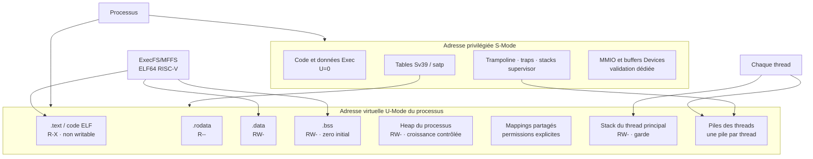
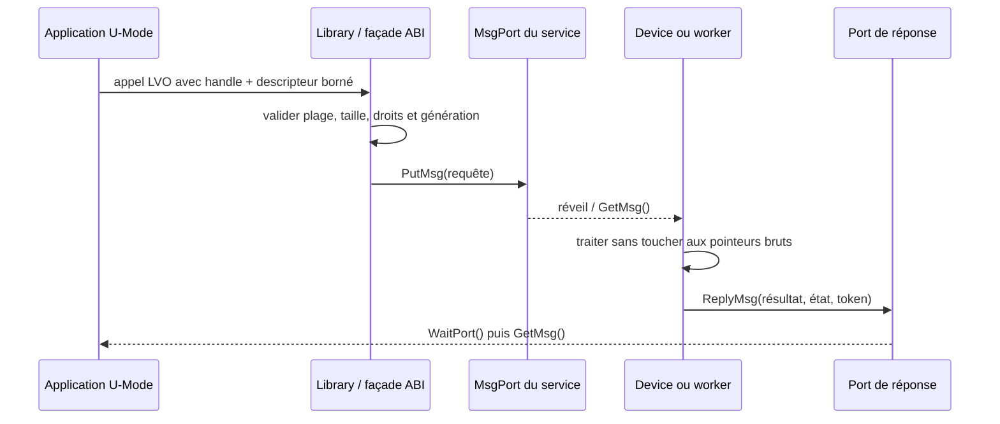
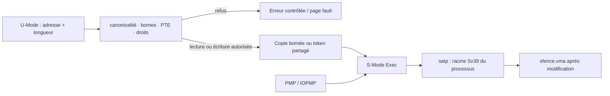
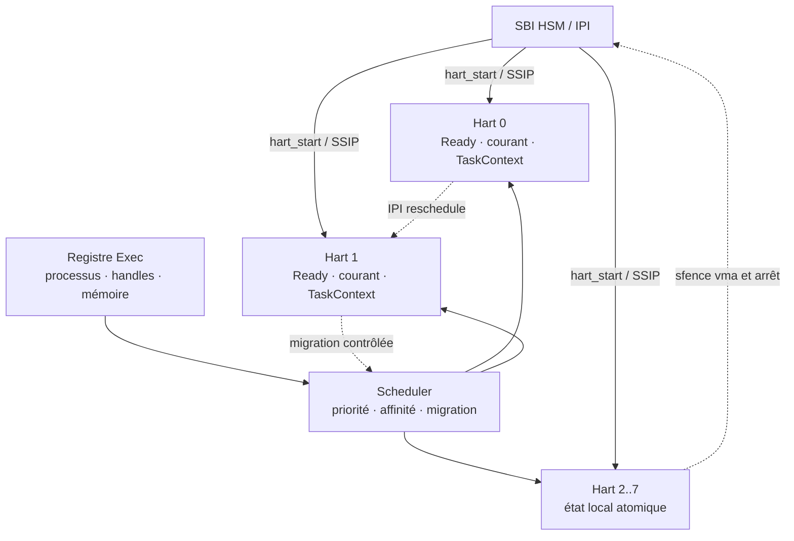
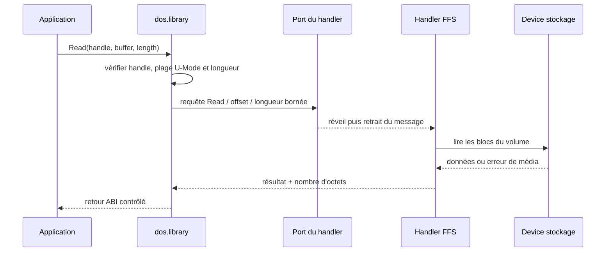
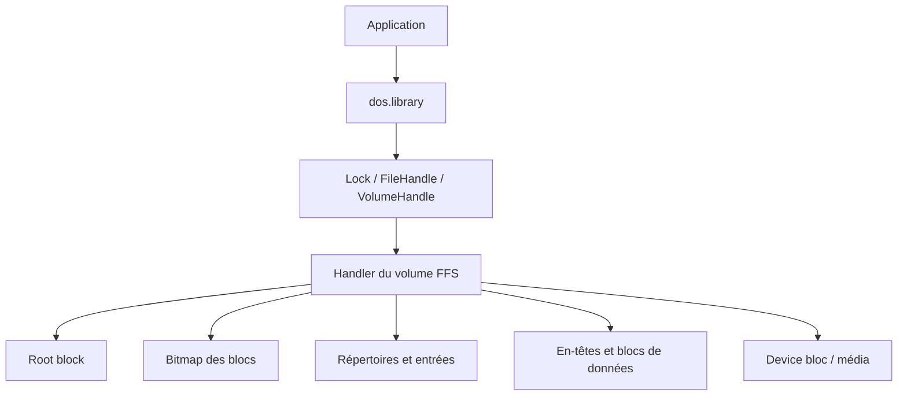
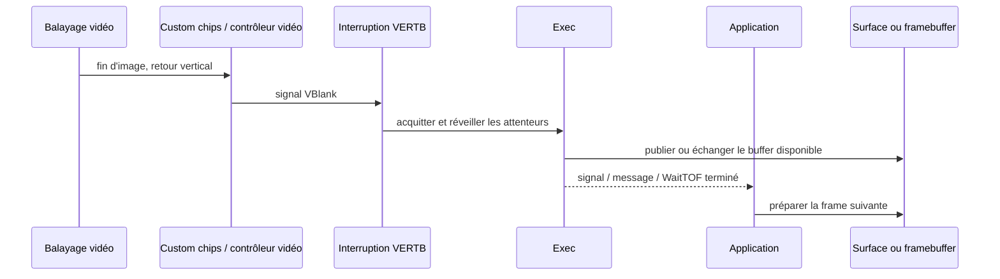
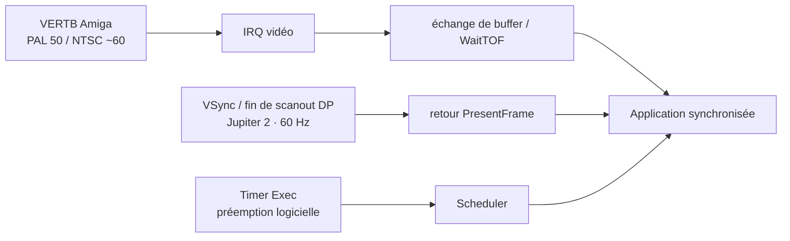

# AmigaOS — histoire et philosophie d’un système qui aurait dû être le meilleur

Ce chapitre présente pourquoi AmigaOS possédait, dès 1985, une avance
architecturale remarquable, et pourquoi cette avance n’a pas suffi à en faire
le système dominant.

## Un pionnier du multimédia et du temps réel

Avant que le mot « multimédia » ne devienne courant, l’Amiga réunissait déjà
graphisme animé, audio numérique, vidéo, entrée utilisateur et multitâche dans
une même machine. Le terme est aujourd’hui daté, mais il décrit une ambition à
réhabiliter : faire coopérer plusieurs flux continus avec une latence faible.

Exec apportait une forte réactivité grâce aux priorités de tâches, aux signaux,
aux interruptions et aux échanges par messages. Il s’agissait d’un système
orienté **temps réel souple** (réponse prévisible et rapide), pas d’un système
temps réel dur garantissant mathématiquement chaque échéance. Cette distinction
doit être conservée dans la V2 : viser la latence bornée sans promettre une
garantie que le matériel ou le scheduler ne peuvent fournir.

## 1. Naissance en 1985

L’Amiga 1000 est lancé en 1985. Carl Sassenrath conçoit Exec comme un noyau
compact orienté tâches, messages et ressources partagées, adapté à une machine
aux ressources limitées mais dotée de capacités graphiques et audio avancées.

## 2. Organisation

```text
Applications
├── Workbench
└── applications utilisateur

Libraries
├── exec.library
├── dos.library
├── intuition.library
├── layers.library
├── graphics.library
├── gadtools.library
└── autres services

Devices
├── input.device
├── audio.device
├── timer.device
└── autres périphériques

Exec
├── tâches
├── mémoire
├── interruptions
└── IPC par messages
```

`dos.library` fournit la façade des fichiers, répertoires, volumes, processus
DOS et flux standard ; elle s'appuie sur Exec et sur le handler du volume. Elle
ne remplace ni Exec ni le Device de stockage.

`layers.library` organise les couches d'affichage : ordre avant/arrière,
clipping, zones endommagées et composition des fenêtres. `gadtools.library`
fournit des gadgets réutilisables comme les boutons, cases, chaînes et listes ;
elle s'appuie sur Intuition pour les fenêtres et sur Graphics pour le rendu.
Ces Libraries gardent la politique d'interface au-dessus d'Exec et des Devices.

Workbench est une application système au-dessus d’Exec, DOS, Intuition et
Graphics. Il n’est pas nécessaire pour lancer une application ou ouvrir un
Screen privé.

## 3. Le clin d’œil Atari TOS et la MAO

L’autre grande famille de l’époque est l’Atari ST (1985) et son **TOS**
(*The Operating System*), construit autour de GEMDOS et de l’interface GEM.
L’Atari ST proposait des ports MIDI intégrés, un coût accessible et une
réactivité appréciée des musiciens. Il a ainsi marqué la naissance de la MAO
moderne : séquenceurs, éditeurs et premiers studios numériques ont été
développés sur ST, notamment Cubase et Notator.

TOS était généralement mono-tâche et moins modulaire qu’AmigaOS, mais cette
simplicité réduisait les surprises dans un séquenceur MIDI. AmigaOS offrait un
multitâche et des capacités audio/vidéo plus riches ; Atari TOS offrait une
chaîne MIDI immédiatement pratique et économique. Les deux ont contribué à
faire entrer l’informatique dans les studios de la génération 1985–1990.

| Système | Atout historique pour les musiciens | Limite principale |
|---|---|---|
| AmigaOS | multimédia, audio/vidéo, multitâche, échantillonnage | environnement MIDI moins intégré |
| Atari TOS/ST | MIDI intégré, séquençage, simplicité, coût | multitâche et multimédia plus limités |

La V2 retient les deux leçons : l’architecture modulaire et multimédia
d’AmigaOS, ainsi que la latence et la simplicité d’un chemin audio/MIDI dédié.

## 4. Video Toaster et LightWave : le multimédia professionnel

Le **Video Toaster** de NewTek, lancé au début des années 1990 pour Amiga,
illustre le passage du multimédia ludique au multimédia professionnel. Cette
solution réunissait sur une même machine des fonctions de commutation vidéo,
incrustation, titrage, effets et production télévisuelle, en s’appuyant sur les
capacités graphiques et d’extension de l’Amiga.

**LightWave 3D** est né dans cet écosystème comme logiciel de modélisation,
d’animation et de rendu associé au Toaster, avant de devenir un produit
autonome. Il a démontré qu’un ordinateur personnel pouvait produire des images
de qualité broadcast et des effets 3D complexes à une époque où ces outils
étaient normalement réservés aux studios spécialisés.

Video Toaster et LightWave ne prouvent pas qu’AmigaOS était sans limites : ils
reposaient sur du matériel et des extensions dédiés. Ils montrent en revanche
la pertinence de sa philosophie : un noyau léger, des Devices spécialisés, des
Libraries accessibles et une application capable d’exploiter directement le
pipeline multimédia.

## 5. Philosophie de Carl Sassenrath

- multitâche préemptif sur une machine peu puissante ;
- processus légers adaptés aux travaux qui doivent partager un même contexte ;
- communication par messages plutôt que dépendance à des appels globaux ;
- noyau et services suffisamment petits pour rester compréhensibles ;
- Devices remplaçables et Libraries accessibles aux applications ;
- séparation entre politique du bureau et services système ;
- exploitation directe des capacités graphiques et audio du matériel.

Cette philosophie explique la sensation de rapidité et de liberté de l’Amiga.

## 6. Limites historiques

L’absence initiale de protection mémoire, la sécurité limitée, la dépendance au
matériel custom et un écosystème commercial fragile ont freiné son évolution.
« Le système qui devait gagner » est une appréciation historique, pas une
conclusion technique démontrable.

AmigaOS était également conçu autour d’un modèle principalement mono-cœur :
son multitâche préemptif permettait d’alterner rapidement les tâches, mais ne
signifiait pas qu’elles s’exécutaient simultanément sur plusieurs cœurs. La V2
conserve l’efficacité du modèle de tâches et l’étend au multicœur/SMP avec des
files par hart, une affinité CPU, des migrations contrôlées, des IPI et une
synchronisation explicite des ressources partagées.

## 7. Héritage pour Exec Modernisé V2

La V2 reprend le petit Exec indépendant, l’IPC explicite, les processus légers,
les contrats Libraries/Devices, le Workbench optionnel et les applications
directes. Elle ajoute protection mémoire, permissions, versionnement ABI,
backends remplaçables, récupération sur erreur et préparation au multicœur,
avec synchronisation et propriété explicites des ressources partagées. Le
socle portable du scheduler V2 sélectionne déjà les tâches par priorité,
répartit les tâches non épinglées entre les harts et refuse les migrations
contraires à l’affinité déclarée.

## 8. La synthèse que nous construisons

L’ambition d’Exec Modernisé V2 est de réunir deux héritages qui étaient
séparés :

```text
Video Toaster + LightWave
→ vidéo professionnelle, 3D, composition et rendu

Atari ST + TOS + MIDI
→ séquençage, audio réactif et contrôle direct par les musiciens
```

La V2 vise une plateforme où ces usages coexistent dans un même système :
pipeline GPU triple-buffered, audio/MIDI à latence bornée, réseau, applications
directes et bureaux interchangeables. La différence décisive est la base
moderne : isolation mémoire, contrats versionnés, sécurité, backpressure et
récupération sur erreur.

Autrement dit, nous construisons le système multimédia que l’Amiga et l’Atari
ST annonçaient, avec les garanties qu’ils ne pouvaient pas encore fournir.

## 9. Une plateforme RISC-V dédiée

Cette synthèse est destinée à une plateforme **RISC-V** moderne. L’ISA ouverte
permet de contrôler le démarrage, les niveaux de privilège, la mémoire et les
extensions sans dépendre d’un fournisseur de processeur fermé. Le SoC (par
exemple Jupiter 2) fournit ensuite les blocs concrets : GPU/DPU, audio,
contrôleur mémoire, stockage et réseau.

Dans ce chapitre, **hart** désigne un *Hardware Thread*, soit une unité
d’exécution RISC-V indépendante. La Jupiter 2 et QEMU avec `-smp 8` exposent
ici huit harts ; le mot ne garantit pas qu’un futur cœur physique ne puisse pas
exposer plusieurs harts via SMT.

Cette abstraction ouvre la voie à des configurations futures : plus de harts
sur les processeurs RVA23, des cœurs réservés à l’audio ou au GPU, une
affinité dynamique et un équilibrage de charge. Exec doit interroger la
topologie fournie par la plateforme et activer tous les harts disponibles ; la
limite actuelle de 64 harts est une capacité de conception du prototype, pas
une limite conceptuelle de RISC-V.

Le démarrage QEMU valide ce principe avec huit harts : un hart principal est
initialisé, puis les sept harts secondaires sont amenés en ligne. Chaque hart
possède ensuite un état de cycle de vie et peut être arrêté proprement. Cette
séquence prépare les futures topologies sans supposer que le hart 0 est le
seul cœur utile.

La règle d’architecture est stricte :

```text
contrats V2 portables
        ↓
adaptateur RISC-V / SoC
        ↓
GPU, audio, réseau et affichage du matériel
```

RISC-V ne rend pas automatiquement le système temps réel ou multimédia. Il faut
encore valider les interruptions, le MMU, la cohérence cache/DMA, les fences GPU
et les latences audio sur le SoC réel. Ces propriétés sont donc des contrats à
mesurer, pas des hypothèses.

## 10. Le modèle Library, les LVO et l'ABI

L'une des idées les plus importantes d'Exec est que l'application ne connaît
pas l'implémentation interne du service. Elle ouvre une **Library**, conserve un
pointeur vers sa base et appelle les fonctions publiques par leurs entrées de
table. Chaque entrée est repérée par un **LVO** (*Library Vector Offset*) : un
offset stable vers un vecteur de fonction. Dans le modèle 68k historique, ces
vecteurs sont généralement placés à des offsets négatifs par rapport à la base
de Library. La valeur exacte dépend de la Library et de sa version ; elle doit
provenir de ses includes et de sa table ABI, jamais d'une supposition.

Les noms que nous conservons comme repères sont notamment `OpenLibrary` et
`CloseLibrary` pour le cycle de vie, ainsi que `ShowWindow`, `HideWindow` et
`DrawGadget` pour les services graphiques et d'interface. Ces noms décrivent
des contrats ; ils ne signifient pas que le code V4 appelle encore directement
une adresse 68k. En V4, la façade publique traduit l'appel vers le dispatcher
Rust et, lorsque c'est nécessaire, vers un service privilégié ou un Device.

Un LVO ne définit pas seulement une position dans une table. Le contrat ABI
comprend aussi :

| Élément | Contrat à préserver |
|---|---|
| entrée | index ou offset LVO, signature et convention d'appel |
| arguments | ordre, largeur, alignement et sens lecture/écriture |
| données | structures, tailles déclarées, endianness et version |
| résultat | valeur de retour, erreur et état des ressources |
| mémoire | propriété des buffers, durée de vie et synchronisation |
| évolution | version minimale, extension compatible et comportement inconnu |

L'application appelle donc une façade, pas une adresse physique de périphérique
et pas une fonction privée du scheduler. `intuition.library` peut gérer une
Window, `graphics.library` peut produire un plan de rendu et un Device peut
piloter le matériel ; leurs frontières restent séparées. Un **Device** est un
service lié à un périphérique ou à un flux matériel, alors qu'une Library
expose une API réutilisable. Cette distinction évite de transformer chaque
application en pilote.


La V4 garde l'ergonomie de ce modèle tout en ajoutant les contrôles absents du
modèle historique : validation de la plage U-Mode avant chaque lecture ou
écriture, tailles bornées, handles opaques avec génération, refus des pointeurs
non canoniques et erreurs explicites. Une évolution ABI peut ajouter une
nouvelle entrée ou une nouvelle version de structure ; elle ne doit pas changer
silencieusement la signification d'une entrée existante.

## 11. L'espace mémoire complet d'une application

Dans AmigaOS historique, une application pouvait partager beaucoup de mémoire
avec le système et les autres tâches. C'était rapide et pratique, mais une
écriture erronée pouvait corrompre une liste Exec, une Library ou le framebuffer.
V4 conserve le chargement simple d'une application tout en donnant à chaque
processus un espace d'adresses propre.

Le chemin de lancement est le suivant : Exec reçoit un nom depuis la façade
DOS, le résolveur cherche l'image dans ExecFS/MFFS, puis le chargeur vérifie le
type, le checksum et l'ELF64 RISC-V. Les seuls segments chargés sont les
`PT_LOAD` valides et bornés. Le kernel réserve les frames physiques, copie les
octets initialisés, met la zone BSS à zéro, réserve le heap et les piles, puis
publie le plan complet de manière transactionnelle. En cas d'erreur, les frames,
les références et le registre du processus sont restaurés.

Une vue logique d'un processus V4 est la suivante. Les adresses sont des zones
conceptuelles ; seules les bornes générales Sv39 et les permissions sont des
contrats fixes. Les valeurs d'adresse propres à une image ne doivent pas être
déduites de ce dessin.



Le **processus** possède l'espace de mémoire, les permissions, les handles et
les ressources autorisées. Le **thread principal** est le premier contexte
exécutable de ce processus. Les threads enfants partagent le même `satp` et
les mêmes mappings du processus, mais chacun possède sa pile utilisateur, sa
pile supervisor associée, son contexte CPU, son identifiant, son état et sa
position dans le scheduler. Une pile n'est donc pas l'espace mémoire complet
de l'application.

Le contrat actuel accepte la fenêtre utilisateur Sv39 de `0x1000` à
`0x3fffffffff`, sur des pages de 4096 octets. Chaque mapping porte des droits
`R`, `W`, `X` et `U`. Le code est exécutable mais non inscriptible, les données
ne sont pas exécutables et les pages supervisor ont `U=0` : c'est la règle
W^X et la séparation U-Mode/S-Mode. `satp` sélectionne la racine de table du
processus lors d'un changement de contexte ; `sfence.vma` rend visible une
modification de traduction.

Le partage initial peut utiliser le **COW** (*copy-on-write*) : deux espaces
voient une page marquée lecture seule, puis un défaut d'écriture alloue une
nouvelle frame, la copie et remplace le PTE du processus fautif. Cette opération
est validée avant publication et compte les références. Les buffers GPU, DMA et
les zones partagées suivent un contrat séparé, car un autre maître de bus ne
doit pas recevoir un pointeur utilisateur non contrôlé.

## 12. Tâches, threads, ports et messages

Exec historique privilégie la coopération explicite par messages. Une tâche
possède un contexte d'exécution ; un processus ajoute un espace mémoire et des
ressources ; un thread léger permet de partager cet espace sans recréer toute
l'image du processus. Le scheduler peut préempter une tâche, mais l'attente
d'un événement doit se faire par une primitive d'attente, pas par une boucle
qui monopolise le CPU.

Un `MsgPort` est un point d'entrée possédant une file de messages protégée et
un mécanisme de réveil. Un message historique contient notamment un nœud de
chaînage, une longueur et un port de réponse. Le contenu applicatif suit ce
préambule. La séquence normale est :

1. l'expéditeur construit un message borné et renseigne son type, sa longueur,
   son identifiant ou sa génération et son payload ;
2. `PutMsg` vérifie le port, place le message dans sa file et réveille son
   propriétaire ;
3. le consommateur utilise `GetMsg` pour retirer le prochain message ;
4. `WaitPort` ou l'attente par signaux bloque le thread jusqu'à l'arrivée d'un
   message, d'un signal ou d'un timeout ;
5. le consommateur traite la requête puis `ReplyMsg` renvoie le résultat et la
   propriété au port de réponse prévu.

Dans V4, une façade Rust doit en plus borner la taille du payload, vérifier la
propriété du port, distinguer une copie de données d'un buffer partagé et
refuser un handle périmé. Les appels `PutMsg`, `GetMsg`, `WaitPort` et
`ReplyMsg` représentent donc une sémantique IPC ; un syscall est le passage
contrôlé U-Mode/S-Mode qui demande cette opération ; une interruption matérielle
est le signal produit par un périphérique. Ces trois notions ne doivent pas
être confondues.

Les Devices utilisent particulièrement ce modèle pour les requêtes
asynchrones : une application envoie une demande audio, stockage ou affichage,
continue son travail, puis attend la réponse sur son port. Le Device ne reçoit
pas une adresse arbitraire à déréférencer ; il reçoit un descripteur validé,
une taille bornée et, si nécessaire, un token de buffer partagé.



Les signaux et les ports permettent de composer des services sans imposer un
appel global bloquant. Ils n'éliminent pas les verrous : les files partagées,
les ressources GPU et les références de buffers gardent leurs propres règles
d'atomicité et de propriété.

## 13. Pourquoi Rust et RISC-V changent le compromis

Rust ne rend pas automatiquement un noyau correct, mais il encode dans le type
de nombreuses règles qui étaient auparavant des conventions en C :

- ownership et borrowing rendent visibles les propriétaires et les aliasages
  mutables des listes, files, handles et tables de pages ;
- les enums d'erreurs empêchent de confondre une absence, un timeout, un fault
  et une ressource épuisée ;
- les slices et les longueurs bornent les copies de messages et les buffers ;
- les types distincts peuvent séparer une adresse utilisateur, un handle, une
  frame physique et un identifiant de thread ;
- les tests du scheduler, de l'ELF, des plans Sv39 et des messages peuvent
  s'exécuter sur l'hôte ou dans QEMU.

Le code `unsafe` reste nécessaire pour les MMIO, les traps, le changement de
contexte, les CSR, les fences et certains buffers DMA. V4 cherche à concentrer
ces opérations dans de petites frontières auditées, puis à exposer au reste du
kernel des invariants vérifiés. Cela réduit les corruptions de listes et de
files qui étaient particulièrement coûteuses dans un Exec sans protection
mémoire.

RISC-V apporte une ISA ouverte et une séparation de privilèges lisible. Dans
le profil V4, le firmware et SBI exécutent les opérations de plateforme au
niveau M lorsque le fournisseur les expose ; Exec fonctionne en **S-Mode** ;
les applications et les Libraries non privilégiées fonctionnent en **U-Mode**.
Un appel de service passe par `ecall`. Le trap arrive à `stvec`, son origine
est décrite par `scause`, l'adresse fautive par `stval`, et le contexte reprend
à `sepc`. Les extensions SBI, dont HSM pour les harts et IPI pour le réveil des
CPU, restent derrière une interface adaptée au SoC.

Cette combinaison permet de porter le même contrat sur QEMU et Jupiter 2,
puis d'isoler les différences de boot, d'interruptions, de cache, de DMA et de
GPU dans les backends matériels. Elle ne promet ni temps réel dur ni absence
de bugs : le projet vise un temps réel souple mesuré, avec une latence et une
charge à caractériser sur la carte réelle.

## 14. Une MMU légère : assez de protection, peu de mécanismes

« Légère » signifie ici que V4 n'introduit pas un hyperviseur ou un modèle de
virtualisation complet pour le premier jalon. La protection repose sur un
chemin court et explicite :

1. des tables de pages **Sv39** à trois niveaux, avec des pages de 4 Kio ;
2. un mapping du kernel, des traps et des Devices partagé avec `U=0`, et un
   mapping utilisateur propre à chaque processus avec `U=1` ;
3. un `satp` par espace d'adresses, chargé lors du changement de contexte ;
4. des permissions `R/W/X`, la séparation W^X et la vérification de chaque
   plage avant une copie U-Mode ;
5. `sfence.vma` après une modification de PTE qui doit être observée par le
   hart ;
6. PMP, et IOPMP lorsque la plateforme le fournit, pour limiter les accès
   physiques du CPU et des autres maîtres de bus.

La validation d'une plage ne déréférence jamais elle-même un pointeur fourni
par l'application. Elle vérifie la canonicalité, les débordements, les pages
présentes et les droits, puis le kernel effectue une copie contrôlée. Cette
séquence est essentielle pour les appels LVO, les syscalls, les messages et
les buffers de rendu.



Le mécanisme est suffisamment petit pour être testé sur hôte et QEMU, tout en
protégeant le kernel contre les erreurs ordinaires d'une application. Les
grandes tables, les mappings de Device et la cohérence cache/DMA restent des
questions de plateforme ; elles ne sont pas masquées derrière la promesse
vague d'une « MMU magique ».

## 15. SMP et multi-hart

Un hart RISC-V est une unité d'exécution indépendante. Le terme ne désigne pas
obligatoirement un cœur physique : avec SMT, un cœur peut exposer plusieurs
harts. Le profil Jupiter 2/QEMU visé ici utilise huit harts. Au démarrage, un
hart principal initialise Exec, demande aux harts secondaires de démarrer par
SBI HSM, puis attend leur publication atomique `Online` avant d'utiliser leurs
files.

Chaque hart possède un état local : pile supervisor, vecteur de trap, thread
courant, snapshot de contexte, `satp` actif, état de boot et demande de
rescheduling. La file `Ready` et l'identité des threads restent coordonnées par
Exec. Le scheduler choisit d'abord la priorité, puis un hart autorisé par
l'affinité : un thread `Any` peut migrer ; un thread épinglé à un masque de
harts ne peut pas être déplacé vers un hart interdit.

Une migration n'est pas une simple écriture d'un numéro de CPU. Elle retire le
thread de la file source, conserve son `TaskContext` et son `satp`, vérifie
l'affinité et la destination, publie le contexte sur la file cible et demande
un réveil par IPI. La transaction doit pouvoir être abandonnée avant mutation
si une file est pleine ou si l'état du thread a changé. Les snapshots atomiques
par hart réduisent la contention, mais ne remplacent pas la synchronisation
des registres globaux, des espaces mémoire et des ressources partagées.

Les IPI/SSIP servent notamment à réveiller un hart, demander une préemption,
propager une invalidation TLB ou ordonner un arrêt. Ils ne sont pas des
messages applicatifs : l'IPI transporte une demande de rescheduling très
courte, puis le scheduler consulte son état partagé. L'audio, le GPU et les
buffers DMA peuvent conserver une affinité stricte jusqu'à validation de leurs
barrières et de leur cohérence cache.



Le modèle portable V2/V4 couvre les règles de priorité, d'affinité, de
répartition et de migration, et le bring-up QEMU valide le démarrage des huit
harts ainsi que le chemin IPI/SSIP. Le scheduler SMP général de production et
la concurrence matérielle complète sur Jupiter 2 restent des validations à
terminer : la documentation distingue volontairement ce qui est testé de ce
qui est encore en développement.

## 16. Ce que V4 conserve et ce qu'elle modernise

```text
AmigaOS / Exec historique             Exec Modernisé V4
──────────────────────────────        ───────────────────────────────
Library + table de vecteurs       →   façade ABI versionnée + LVO documentés
Task / Process                     →   thread + processus + espace Sv39 privé
MsgPort + PutMsg/GetMsg            →   IPC borné, handles et propriété vérifiée
Device                             →   worker matériel + buffers validés
priorités et signaux               →   scheduler SMP + affinité + IPI
mémoire partagée rapide            →   U/S, PMP, W^X, COW et DMA contrôlé
68000 et matériel custom           →   Rust + RISC-V + backends Jupiter 2/QEMU
```

La continuité avec AmigaOS est donc dans les frontières compréhensibles,
l'orientation messages, les services remplaçables et la réactivité. La rupture
est dans les garanties : l'application n'est plus autorisée à écrire librement
dans la mémoire du kernel, un message ne porte pas une taille illimitée, et un
hart supplémentaire ne peut pas partager une ressource sans règle de
propriété. C'est cette combinaison qui donne à V4 une chance de retrouver la
directité de l'Amiga sur une machine moderne sans reproduire ses fragilités.

## 17. `dos.library`, les handlers et le FFS

### `dos.library` : la façade que voit l'application

Dans AmigaOS, `dos.library` n'est pas le disque et n'est pas Exec. C'est la
Library qui fournit aux applications les opérations DOS : ouvrir et fermer un
fichier, lire, écrire, déplacer le curseur, obtenir un verrou sur un objet,
parcourir un répertoire, créer ou supprimer un répertoire, lancer un processus
et utiliser les flux standard. Les noms historiques les plus représentatifs
sont `Open`, `Close`, `Read`, `Write`, `Seek`, `Lock`, `UnLock`, `Examine` et
`ExNext`. Les entrées sont des contrats de Library ; elles ne doivent pas
connaître les registres du contrôleur disque.

La façade gère aussi le contexte DOS d'un processus : répertoire courant,
entrée/sortie/erreur standard, arguments de commande et environnement. Le
Shell est une application qui consomme ces services ; il n'est pas le système
de fichiers et n'est pas obligatoire pour qu'une application ouvre un fichier.
Workbench peut lancer une application par cette façade, mais Exec peut aussi
créer directement le processus principal.

Le modèle historique employait des références adaptées à l'ABI 68k, notamment
les **BPTR** dans plusieurs structures DOS : un BPTR représente un pointeur
encodé selon la convention BCPL, généralement obtenu à partir d'une adresse
alignée. Un handle de fichier, un verrou ou un pointeur utilisateur ne doit
donc pas être confondu avec une adresse C ordinaire. Les versions modernes du
projet remplacent cette convention fragile par des handles opaques, typés,
bornés et associés à un propriétaire et à une génération.

| Couche | Responsabilité | Exemple de contrat |
|---|---|---|
| application | demander une opération | chemin, mode et buffer borné |
| `dos.library` | normaliser, vérifier et présenter l'ABI | handle fichier ou volume |
| Exec | threads, mémoire, attente et handles | `ThreadCreate`, ports, permissions |
| handler de volume | interpréter les requêtes du système de fichiers | fichier, répertoire, bitmap |
| Device stockage | blocs, interruptions et DMA | UFS, VirtIO-blk ou autre backend |

En V4, le contrat hérité de V2 normalise les chemins, refuse les NUL, les
sorties de racine et les débordements, borne chaque lecture ABI à 4 Kio avant
de la découper, et distingue les handles de fichier, répertoire, volume et
processus. `Move` reste atomique sur un même volume ; entre deux volumes, il
devient une copie explicite et contrôlée. Le code DOS ne possède ni le
scheduler, ni l'allocateur de frames, ni le transport physique du stockage.

### Pourquoi le système de fichiers est un service par messages

Un volume Amiga est servi par un **handler**, c'est-à-dire une tâche ou un
processus qui possède un `MsgPort`. `dos.library` transforme un appel comme
`Read` en requête bornée adressée au handler du volume. La requête indique une
action, un handle ou un verrou, un offset, une longueur et, selon l'action, un
buffer ou un résultat. Le handler exécute l'opération, demande au Device les
blocs nécessaires, puis renvoie le code de résultat et le nombre d'octets
traités. L'application n'appelle jamais directement le code du handler.



Ce découpage explique la puissance du modèle AmigaOS : un nouveau Device de
stockage peut servir le même contrat DOS, et un nouveau handler peut présenter
un autre format sans modifier chaque application. Il impose en contrepartie
des règles de verrouillage, de propriété des buffers et de récupération après
erreur. V4 garde cette séparation, mais vérifie les pointeurs U-Mode et
remplace les paquets non bornés par des descripteurs Rust de taille explicite.

### FFS : le Fast File System historique

Le **FFS** (*Fast File System*) est le système de fichiers rapide de la famille
Amiga. Il se place sous `dos.library` comme un handler de volume. Une
application ne demande pas « du FFS » : elle demande `Open` ou `Read` à DOS, et
le handler FFS traduit cette opération en accès aux structures du volume.

À gros traits, un volume FFS contient :

- un bloc de démarrage permettant de rendre le volume amorçable lorsqu'il est
  prévu pour cela ;
- un bloc racine qui identifie le volume et relie les structures principales ;
- une bitmap qui décrit les blocs libres et occupés ;
- des blocs de répertoires et d'entrées de fichiers ;
- des en-têtes de fichiers et des pointeurs vers les blocs de données ;
- des checksums et liens de structure permettant au handler de détecter des
  incohérences.

FFS et OFS exposent la même idée de volume DOS, mais leur organisation et le
  coût des accès aux données diffèrent. FFS évite une partie du travail de
  chaînage et de vérification par bloc de données qui rendait l'OFS plus lent,
  particulièrement pour les fichiers volumineux. Cette distinction concerne
  le format et le handler ; elle ne change pas l'ABI visible par `dos.library`.
Les variantes et options de compatibilité doivent être identifiées par le
descripteur du volume, pas devinées à partir d'un nom de fichier.



### FFS historique, ExecFS et MFFS V4

Il faut distinguer trois notions qui ont souvent été mélangées dans les
premiers documents :

| Nom | Nature | Rôle dans le projet |
|---|---|---|
| FFS | format et handler historiques AmigaOS | référence historique de la couche DOS/volume |
| ExecFS | espace de noms logique du projet | trouver des applications et leurs ressources |
| MFFS V1 | image catalogue portable du projet | emballer et valider des entrées ELF/Data |

Le `filesystem-v4` actuel ne monte pas encore un volume FFS Amiga et ne parle
pas directement à un disque UFS. Il valide une image MFFS V1 en mémoire : la
signature est `EXFS`, la version est `1`, les entrées font 64 octets et les
payloads sont contrôlés par leurs bornes et leur checksum FNV-1a. Le programme
hôte `mffs-pack` valide d'abord un ELF64 RISC-V statique, puis construit cette
image ; Exec réserve ensuite les frames, copie les segments `PT_LOAD` et
construit l'espace Sv39.

Le MFFS de V4 est donc un format de démarrage compact et déterministe, utile
pour prouver la chaîne :

```text
image MFFS en mémoire
  → lookup du nom
  → validation checksum et type APP
  → validation ELF64 RISC-V
  → allocation Exec
  → espace Sv39 U-Mode
  → processus et thread principal
```

Il ne remplace pas encore le travail complet d'un volume persistant : montage,
allocation de blocs, création de fichiers, bitmap, locks de volume, cache,
journalisation éventuelle, retrait du média et reprise après coupure restent
des étapes distinctes. La future `dos.library` pourra garder la même façade
qu'un volume FFS, tandis qu'un backend MFFS/ExecFS, UFS ou VirtIO fournira le
stockage réel. C'est cette stabilité de la façade qui permettra de charger une
application depuis la Jupiter 2 sans lier l'application aux détails du média.

## 18. L'interruption d'écran : VBlank, PAL et NTSC

Sur Amiga, l'« interruption écran » désigne principalement l'interruption de
retour vertical, souvent appelée **VERTB** ou **VBlank** (*vertical blanking
interval*). Le balayage vidéo termine une image, remonte vers le haut de
l'écran et fournit une courte période pendant laquelle le système peut
préparer la prochaine image. Le matériel custom signale cet événement au
contrôleur d'interruptions ; Exec réveille alors les tâches qui attendent ce
repère au lieu de faire tourner une boucle d'attente.

La fréquence dépend du standard vidéo sélectionné :

| Standard | Cadence nominale | Conséquence |
|---|---:|---|
| PAL | 50 Hz | environ une interruption VERTB toutes les 20 ms |
| NTSC | 59,94 Hz, souvent arrondi à 60 Hz | environ une interruption toutes les 16,7 ms |

PAL et NTSC ne sont donc pas deux modes du scheduler. Ce sont des cadences et
des timings de balayage vidéo ; Exec reçoit un événement matériel et peut s'en
servir pour synchroniser une animation, un double buffer ou un `WaitTOF`.
Une application qui dépend de 50 ou 60 appels par seconde doit mesurer le mode
actif et ne pas supposer que le nombre d'images par seconde est identique à la
fréquence CPU.

Il faut séparer trois événements souvent confondus :

- **VBlank/VERTB** : début du nouveau champ ou de la nouvelle image, utile pour
  publier une frame et éviter de modifier une surface en cours de scanout ;
- **interruption de ligne ou événement Copper** : position précise dans le
  balayage, utile aux effets raster et aux changements de registres, mais plus
  sensible au timing vidéo ;
- **timer Exec** : cadence de préemption et de réveil logiciel, indépendante du
  standard PAL/NTSC, même si elle peut être ajustée pour coopérer avec le
  rafraîchissement.



Le double buffering répond à un problème concret : si le CPU ou un Device
modifie la surface que le balayage lit déjà, l'écran peut montrer une image
déchirée (*tearing*). La synchronisation VBlank permet de changer le pointeur
de buffer au bon moment. Elle ne garantit pas que l'application a terminé sa
frame : si le rendu dépasse 20 ms en PAL ou 16,7 ms en NTSC, la présentation
est retardée ou une image est répétée.

La différence avec l'affichage V4 est volontaire. La Jupiter 2 utilise ici un
mode DisplayPort numérique 1600×900 à 60 Hz via l'adaptateur USB-C/HDMI ; elle
n'émet pas un signal PAL ou NTSC. Le Device d'affichage doit fournir un
événement de fin de frame ou de VSync après le scanout, puis Graphics peut
retirer le token de présentation et réutiliser le buffer. Le lien DP, l'AUX et
le training déterminent si le moniteur reçoit le signal, tandis que la cadence
de 60 Hz détermine la période de présentation : ce sont deux contrats
différents.



Dans l'architecture Rust, l'interruption matérielle doit rester courte : elle
acquitte la source, publie un état atomique et réveille un worker ou un port.
La composition, la validation des tokens et les opérations GPU se font hors
de cette frontière. Cette règle conserve l'idée Amiga de réactivité tout en
évitant qu'une interruption vidéo accède directement aux structures privées
de l'application.
