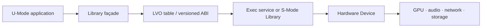
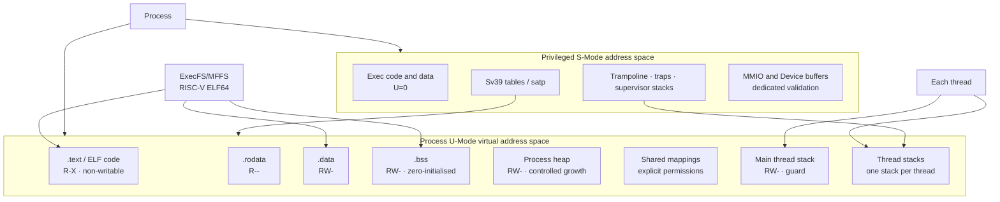
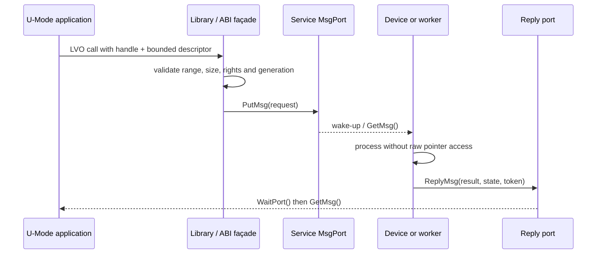
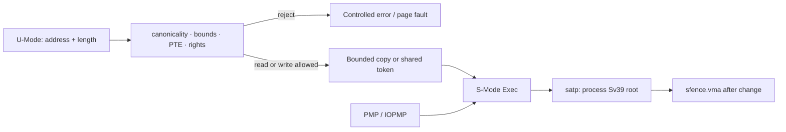
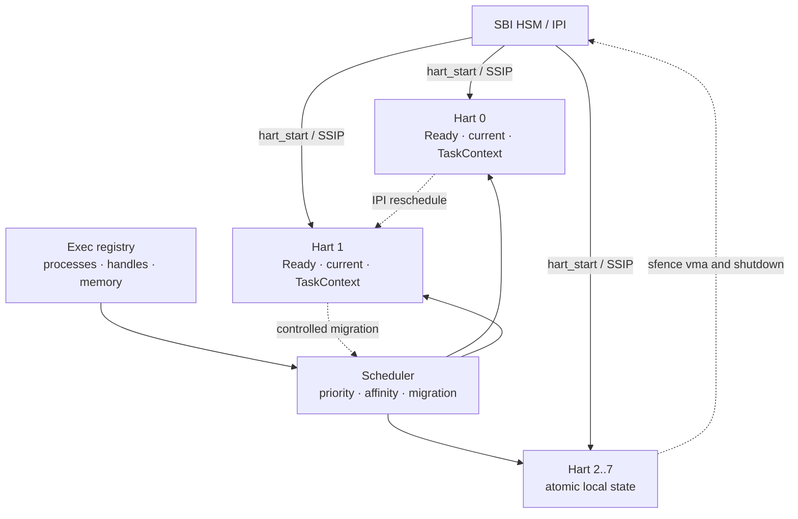
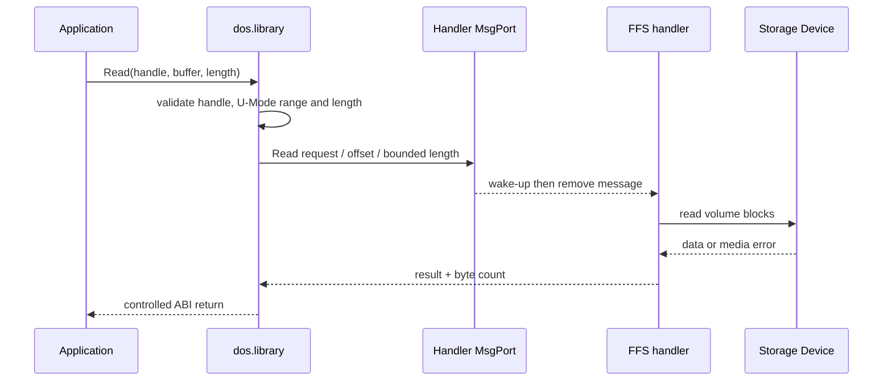
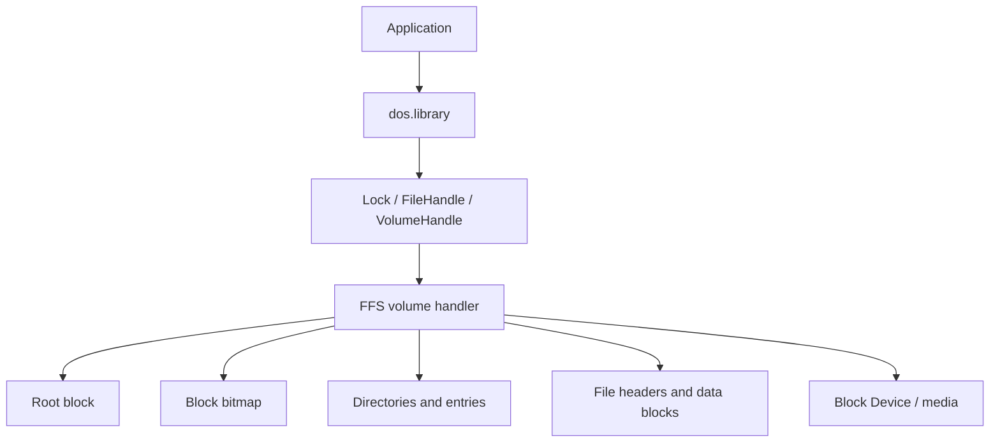
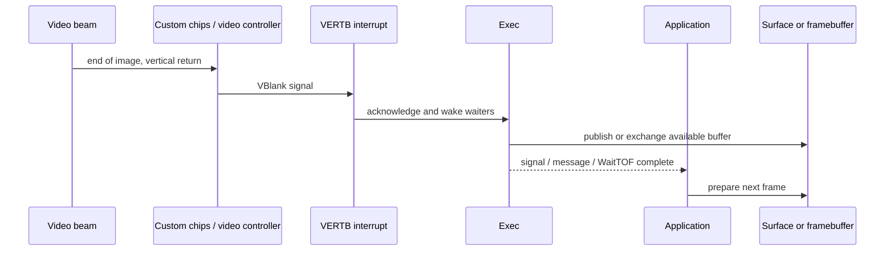
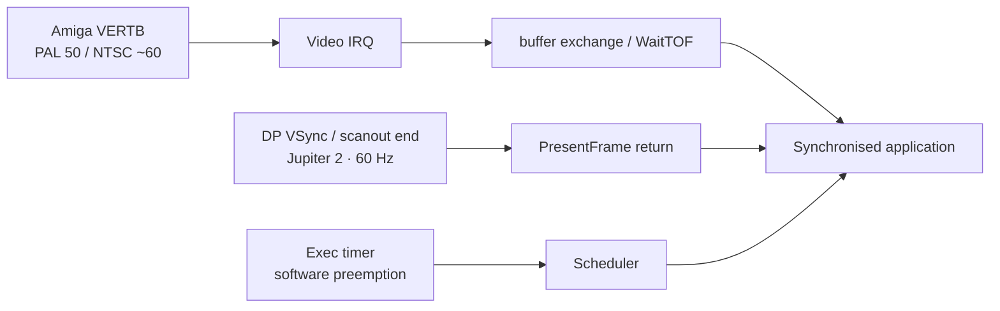

# AmigaOS — history and philosophy of a system that should have been the best

**Language:** [Français](AMIGAOS_HISTORY.md) · **English**

This chapter explains why AmigaOS had a remarkable architectural lead as early
as 1985, and why that lead was not enough to make it the dominant system.

## A multimedia and soft-real-time pioneer

Before the word “multimedia” became common, the Amiga already combined
animated graphics, digital audio, video, user input and multitasking in one
machine. The term is dated today, but it describes an ambition worth keeping:
make several continuous streams cooperate with low latency.

Exec was highly responsive because of task priorities, signals, interrupts and
message passing. It was a **soft-real-time** system, with fast and predictable
responses, rather than a hard-real-time system that mathematically guarantees
every deadline. V4 keeps this distinction: it targets bounded latency without
promising a guarantee that the hardware or scheduler cannot provide.

## 1. Birth in 1985

The Amiga 1000 launched in 1985. Carl Sassenrath designed Exec as a compact
kernel centred on tasks, messages and shared resources, suited to a machine
with limited resources but advanced graphics and audio capabilities.

## 2. Organisation

```text
Applications
├── Workbench
└── user applications

Libraries
├── exec.library
├── dos.library
├── intuition.library
├── layers.library
├── graphics.library
├── gadtools.library
└── other services

Devices
├── input.device
├── audio.device
├── timer.device
└── other peripherals

Exec
├── tasks
├── memory
├── interrupts
└── message-based IPC
```

`dos.library` is the façade for files, directories, volumes, DOS processes and
standard streams. It relies on Exec and on a volume handler; it is neither Exec
nor the storage Device.

`layers.library` manages display layers, front-to-back order, clipping, damage
regions and window composition. `gadtools.library` provides reusable gadgets
such as buttons, checkboxes, strings and lists; it relies on Intuition for
windows and on Graphics for rendering. These Libraries keep interface policy
above Exec and the Devices.

Workbench is a system application above Exec, DOS, Intuition and Graphics. It
is optional: an application can start and open a private Screen without it.

## 3. The Atari TOS and music-production connection

The other major computer family of the period was the Atari ST (1985) and its
**TOS** (*The Operating System*), built around GEMDOS and the GEM interface.
The Atari ST offered built-in MIDI ports, an affordable price and a response
time musicians appreciated. It helped establish modern computer music:
sequencers, editors and early digital studios were developed on the ST,
including Cubase and Notator.

TOS was generally single-tasking and less modular than AmigaOS, but that
simplicity reduced surprises in a MIDI sequencer. AmigaOS offered richer
multitasking and audio/video capabilities; Atari TOS offered a practical,
affordable MIDI chain. Both brought computers into the studios of the
1985–1990 generation.

| System | Historical strength for musicians | Main limitation |
|---|---|---|
| AmigaOS | multimedia, audio/video, multitasking, sampling | less integrated MIDI environment |
| Atari TOS/ST | integrated MIDI, sequencing, simplicity, price | more limited multitasking and multimedia |

V4 keeps both lessons: AmigaOS modular multimedia architecture, and the low
latency and simplicity of a dedicated audio/MIDI path.

## 4. Video Toaster and LightWave: professional multimedia

NewTek’s **Video Toaster**, released for the Amiga in the early 1990s, showed
the move from hobbyist multimedia to professional production. It combined
video switching, keying, titling, effects and television production on one
machine, using the Amiga’s graphics and expansion capabilities.

**LightWave 3D** grew in this ecosystem as the modelling, animation and
rendering software associated with the Toaster before becoming an independent
product. It showed that a personal computer could produce broadcast-quality
images and complex 3D effects at a time when such tools were normally limited
to specialist studios.

Video Toaster and LightWave did not make AmigaOS limitless: they relied on
dedicated hardware and extensions. They did demonstrate the value of its
philosophy: a small kernel, specialised Devices, accessible Libraries and an
application able to use the multimedia pipeline directly.

## 5. Carl Sassenrath’s philosophy

- preemptive multitasking on a low-power machine;
- lightweight processes for work sharing one context;
- message communication instead of dependence on global calls;
- a kernel and services small enough to understand;
- replaceable Devices and application-accessible Libraries;
- separation between desktop policy and system services;
- direct use of the hardware’s graphics and audio capabilities.

This philosophy explains the Amiga’s feeling of speed and freedom.

## 6. Historical limits

The initial lack of memory protection, limited security, dependence on custom
hardware and a fragile commercial ecosystem slowed its development. “The
system that should have won” is a historical judgement, not a demonstrable
technical conclusion.

AmigaOS was also designed mainly around a single-core model: preemptive
multitasking switched quickly between tasks, but did not mean that tasks ran
simultaneously on multiple cores. V4 keeps the task model and extends it to
SMP with per-hart queues, CPU affinity, controlled migration, IPIs and explicit
synchronisation of shared resources.

## 7. What Exec Modernise V2 inherits

V2 keeps the small independent Exec, explicit IPC, lightweight processes,
Library/Device contracts, optional Workbench and direct applications. It adds
memory protection, permissions, versioned ABIs, replaceable backends, error
recovery and preparation for multicore execution, with explicit ownership and
synchronisation of shared resources. The portable V2 scheduler already selects
by priority, distributes unpinned tasks between harts and rejects migrations
that violate affinity.

## 8. The synthesis we are building

Exec Modernise V2 brings together two legacies that were once separate:

```text
Video Toaster + LightWave
→ professional video, 3D, compositing and rendering

Atari ST + TOS + MIDI
→ sequencing, responsive audio and direct musician control
```

V2 targets a platform where these uses coexist: a triple-buffered GPU pipeline,
bounded-latency audio/MIDI, networking, direct applications and replaceable
desktops. The decisive difference is the modern foundation: memory isolation,
versioned contracts, security, backpressure and error recovery.

In other words, we are building the multimedia system that the Amiga and
Atari ST announced, with guarantees they could not yet provide.

## 9. A dedicated RISC-V platform

This synthesis targets a modern **RISC-V** platform. The open ISA allows the
project to control boot, privilege levels, memory and extensions without
depending on a closed processor supplier. The SoC, such as Jupiter 2, then
provides the concrete GPU/DPU, audio, memory, storage and network blocks.

In this chapter, **hart** means a *Hardware Thread*, an independent RISC-V
execution unit. Jupiter 2 and QEMU with `-smp 8` expose eight harts here; the
word does not imply that a future physical core cannot expose several harts
through SMT.

This abstraction supports future configurations: more harts on RVA23
processors, cores reserved for audio or GPU work, dynamic affinity and load
balancing. Exec must query the platform topology and enable all available
harts. The current limit of 64 harts is a prototype design capacity, not a
conceptual RISC-V limit.

The QEMU boot validates this principle with eight harts: one primary hart is
initialised, then seven secondary harts are brought online. Each hart has a
lifecycle state and can be stopped cleanly. This prepares future topologies
without assuming that hart 0 is the only useful core.

The architecture rule is strict:

```text
portable V2 contracts
        ↓
RISC-V / SoC adapter
        ↓
hardware GPU, audio, network and display
```

RISC-V does not automatically make the system real-time or multimedia-ready.
Interrupts, the MMU, cache/DMA coherency, GPU fences and audio latency still
have to be validated on the real SoC. These are measured contracts, not
assumptions.

## 10. Libraries, LVOs and the ABI

One of Exec’s most important ideas is that an application does not know the
service’s internal implementation. It opens a **Library**, keeps a pointer to
its base and calls public functions through the Library table. Each entry is
identified by an **LVO** (*Library Vector Offset*): a stable offset to a
function vector. In the historical 68k model, these vectors were generally at
negative offsets from the Library base. The exact value depends on the Library
and version; it must come from its includes and ABI table, never from a guess.

The verified names retained as reference points include `OpenLibrary` and
`CloseLibrary` for the lifecycle, and `ShowWindow`, `HideWindow` and
`DrawGadget` for graphics and interface services. These names describe
contracts; V4 does not call a 68k address directly. The V4 façade translates
the call to the Rust dispatcher and, when needed, to a privileged service or a
Device.

An LVO is more than a table position. The ABI also specifies:

| Element | Contract to preserve |
|---|---|
| entry | LVO index or offset, signature and calling convention |
| arguments | order, width, alignment and read/write meaning |
| data | structures, declared sizes, endianness and version |
| result | return value, error and resource state |
| memory | buffer ownership, lifetime and synchronisation |
| evolution | minimum version, compatible extension and unknown behaviour |

An application therefore calls a façade, never a physical device address or a
private scheduler function. `intuition.library` can manage a Window,
`graphics.library` can produce a render plan and a Device can drive hardware;
their boundaries remain separate. A **Device** is tied to a peripheral or
hardware stream, while a Library exposes a reusable API.



V4 keeps this ergonomics while adding the missing controls: validate the
U-Mode range before every read or write, bound sizes, use opaque generational
handles, reject non-canonical pointers and return explicit errors. An ABI
extension may add an entry or a new structure version; it must not silently
change an existing entry’s meaning.

## 11. The complete memory space of an application

Historically, an AmigaOS application could share a great deal of memory with
the system and other tasks. This was fast and convenient, but an invalid write
could corrupt an Exec list, a Library or the framebuffer. V4 keeps simple
application loading while giving each process its own address space.

The launch path is: Exec receives a name from the DOS façade, the resolver
finds the image in ExecFS/MFFS, and the loader checks its type, checksum and
RISC-V ELF64 structure. Only valid, bounded `PT_LOAD` segments are loaded. The
kernel reserves physical frames, copies initialised bytes, clears BSS, reserves
the heap and stacks, then publishes the complete plan transactionally. On
failure, frames, references and the process registry are restored.

The following is a logical view. Addresses are conceptual zones; the general
Sv39 bounds and permissions are the contracts. Image-specific addresses must
not be inferred from this drawing.



The **process** owns the memory space, permissions, handles and authorised
resources. The **main thread** is the first executable context. Child threads
share the process’s `satp` and mappings, but each has its own user stack,
associated supervisor stack, CPU context, identifier, state and scheduler
position. A stack is therefore not the application’s complete memory space.

The current contract accepts the Sv39 user window from `0x1000` to
`0x3fffffffff`, using 4096-byte pages. Each mapping carries `R`, `W`, `X` and
`U` permissions. Code is executable but not writable, data is not executable,
and supervisor pages have `U=0`: this is W^X and U-Mode/S-Mode separation.
`satp` selects the process page-table root during a context switch;
`sfence.vma` makes a translation change visible.

Initial sharing can use **COW** (*copy-on-write*): two spaces see a read-only
page, then a write fault allocates a new frame, copies the page and replaces
the PTE of the faulting process. The operation is validated before publication
and reference-counted. GPU, DMA and shared buffers follow a separate contract,
because another bus master must never receive an unchecked user pointer.

## 12. Tasks, threads, ports and messages

Historical Exec favoured explicit cooperation through messages. A task owns an
execution context; a process adds an address space and resources; a lightweight
thread shares that space without recreating the whole process image. The
scheduler may preempt a task, but waiting for an event must use a wait
primitive rather than a loop that monopolises the CPU.

A `MsgPort` is an endpoint with a protected message queue and a wake-up
mechanism. A historical message contains, among other fields, a chaining node,
a length and a reply port. Application data follows that header. The normal
sequence is:

1. the sender builds a bounded message with a type, length, identifier or
   generation and payload;
2. `PutMsg` checks the port, queues the message and wakes its owner;
3. the consumer uses `GetMsg` to remove the next message;
4. `WaitPort`, or signal-based waiting, blocks the thread until a message,
   signal or timeout arrives;
5. the consumer handles the request and `ReplyMsg` returns the result and
   ownership to the designated reply port.

In V4, a Rust façade must also bound the payload, check port ownership,
distinguish copied data from a shared buffer and reject stale handles.
`PutMsg`, `GetMsg`, `WaitPort` and `ReplyMsg` describe IPC semantics; a syscall
is the controlled U-Mode/S-Mode crossing that requests the operation; a
hardware interrupt is the signal produced by a peripheral. These three things
must not be confused.

Devices use this model for asynchronous requests: an application sends an
audio, storage or display request, continues its work and waits for the reply
on a port. The Device receives a validated descriptor, a bounded length and,
when needed, a shared-buffer token, never an arbitrary pointer to dereference.



Signals and ports compose services without imposing one global blocking call.
They do not remove locks: shared queues, GPU resources and buffer references
still need explicit atomicity and ownership rules.

## 13. Why Rust and RISC-V change the trade-off

Rust does not automatically make a kernel correct, but its types encode rules
that used to be conventions in C:

- ownership and borrowing expose owners and mutable aliasing in lists, queues,
  handles and page tables;
- error enums distinguish absence, timeout, fault and resource exhaustion;
- slices and lengths bound message and buffer copies;
- distinct types can separate a user address, handle, physical frame and thread
  identifier;
- scheduler, ELF, Sv39-plan and message tests can run on the host or in QEMU.

`unsafe` is still needed for MMIO, traps, context switching, CSRs, fences and
some DMA buffers. V4 concentrates those operations in small audited boundaries
and exposes checked invariants to the rest of the kernel. This reduces list and
queue corruption that was especially costly in an unprotected Exec.

RISC-V provides an open ISA and a clear privilege separation. In the V4
profile, firmware and SBI perform platform operations at M level when exposed
by the provider; Exec runs in **S-Mode**; unprivileged applications and
Libraries run in **U-Mode**. A service call uses `ecall`. The trap enters at
`stvec`, its cause is in `scause`, the fault address in `stval`, and execution
resumes from `sepc`. SBI extensions, including HSM for harts and IPI for CPU
wake-up, remain behind a SoC adapter.

This combination carries the same contracts to QEMU and Jupiter 2 while
isolating boot, interrupt, cache, DMA and GPU differences in hardware backends.
It promises neither hard real-time nor bug-free code: the project targets
measured soft-real-time behaviour, with latency and load characterised on the
real board.

## 14. A lightweight MMU: enough protection, few mechanisms

“Lightweight” means that V4 does not add a full hypervisor or virtualisation
model for the first milestone. Protection follows a short, explicit path:

1. three-level **Sv39** page tables with 4 KiB pages;
2. a shared mapping for the kernel, traps and Devices with `U=0`, plus a
   private user mapping for each process with `U=1`;
3. one `satp` value per address space, loaded during a context switch;
4. `R/W/X` permissions, W^X and range checks before every U-Mode copy;
5. `sfence.vma` after a PTE change that must be observed by the hart;
6. PMP, and IOPMP when the platform provides it, to limit physical access by
   the CPU and other bus masters.

Range validation never dereferences the application pointer. It checks
canonicality, overflow, present pages and rights, then the kernel performs a
controlled copy. This sequence is essential for LVO calls, syscalls, messages
and render buffers.



The mechanism is small enough to test on the host and QEMU while protecting
the kernel from ordinary application errors. Large tables, Device mappings
and cache/DMA coherency remain platform questions; they are not hidden behind
a vague promise of a “magic MMU”.

## 15. SMP and multiple harts

A RISC-V hart is an independent execution unit. It does not necessarily mean
a physical core: with SMT, one physical core can expose several harts. The
Jupiter 2/QEMU target profile uses eight harts. At boot, a primary hart
initialises Exec, asks secondary harts to start through SBI HSM and waits for
their atomic `Online` publication before using their queues.

Each hart owns local state: a supervisor stack, trap vector, current thread,
context snapshot, active `satp`, boot state and reschedule request. Ready
queues and thread identity are coordinated by Exec. The scheduler selects by
priority first, then a hart allowed by affinity: an `Any` thread may migrate;
a thread pinned to a hart mask cannot move to a forbidden hart.

A migration is not just writing a CPU number. It removes the thread from the
source queue, preserves its `TaskContext` and `satp`, checks affinity and the
destination, publishes the context on the target queue and requests an IPI
wake-up. The transaction must be abortable before mutation if a queue is full
or the thread state changed. Atomic per-hart snapshots reduce contention, but
do not replace synchronisation for global registers, address spaces and shared
resources.

IPI/SSIP is used to wake a hart, request preemption, propagate a TLB
invalidation or order a shutdown. It is not an application message: the IPI
carries a short rescheduling request, and the scheduler then reads shared
state. Audio, GPU and DMA buffers may keep strict affinity until their barriers
and cache coherency are validated.



The portable V2/V4 model covers priority, affinity, distribution and
migration rules, and QEMU bring-up validates eight-hart startup and the
IPI/SSIP path. The production SMP scheduler and complete hardware concurrency
on Jupiter 2 remain open validations; the documentation deliberately
separates tested behaviour from work in progress.

## 16. What V4 keeps and modernises

```text
Historical AmigaOS / Exec          Exec Modernise V4
──────────────────────────         ───────────────────────────────
Library + vector table         →   versioned ABI façade + documented LVOs
Task / Process                 →   thread + process + private Sv39 space
MsgPort + PutMsg/GetMsg        →   bounded IPC, checked ownership handles
Device                         →   hardware worker + validated buffers
priorities and signals         →   SMP scheduler + affinity + IPI
fast shared memory             →   U/S, PMP, W^X, COW and controlled DMA
68000 and custom hardware      →   Rust + RISC-V + Jupiter 2/QEMU backends
```

Continuity with AmigaOS lies in understandable boundaries, message-oriented
services, replaceable components and responsiveness. The guarantees change:
an application may no longer write freely into kernel memory, a message has a
bounded size, and an additional hart cannot share a resource without an
ownership rule. This combination aims to recover the Amiga’s directness on a
modern machine without reproducing its weaknesses.

## 17. `dos.library`, handlers and FFS

### `dos.library`: the application-facing façade

In AmigaOS, `dos.library` is neither the disk nor Exec. It is the Library that
offers file and process operations: open and close a file, read, write, seek,
lock an object, examine a directory, create or remove a directory, launch a
process and use standard streams. Representative historical names include
`Open`, `Close`, `Read`, `Write`, `Seek`, `Lock`, `UnLock`, `Examine` and
`ExNext`. These are Library contracts; they must not know the disk controller
registers.

The façade also carries a process’s DOS context: current directory,
standard input/output/error, command arguments and environment. The Shell is an
application that consumes these services; it is not the file system and is not
required for an application to open a file. Workbench can launch an
application through this façade, while Exec can also create the main process
directly.

The historical ABI used representations adapted to 68k, including **BPTRs**
in several DOS structures. A BPTR is a pointer encoded according to the BCPL
convention, generally derived from an aligned address. A file handle, lock and
user pointer must therefore not be confused with an ordinary C address. Modern
project interfaces replace this fragile convention with opaque, typed,
bounded handles associated with an owner and a generation.

| Layer | Responsibility | Contract example |
|---|---|---|
| application | request an operation | path, mode and bounded buffer |
| `dos.library` | normalise, validate and expose the ABI | file or volume handle |
| Exec | threads, memory, waiting and handles | `ThreadCreate`, ports, permissions |
| volume handler | interpret file-system requests | file, directory, bitmap |
| storage Device | blocks, interrupts and DMA | UFS, VirtIO-blk or another backend |

In V4, the V2-derived contract normalises paths, rejects NUL bytes, root
escapes and overflows, limits each ABI read to 4 KiB before splitting it, and
distinguishes file, directory, volume and process handles. `Move` is atomic on
one volume; across volumes it becomes an explicit, controlled copy. DOS code
owns neither the scheduler, the frame allocator nor the physical storage
transport.

### Why the file system is a message service

An Amiga volume is served by a **handler**, a task or process with a `MsgPort`.
`dos.library` turns a call such as `Read` into a bounded request addressed to
the volume handler. The request carries an action, a handle or lock, an offset,
a length and, depending on the action, a buffer or result. The handler performs
the operation, asks the Device for the required blocks and returns a result
code and byte count. The application never calls handler code directly.



This separation is one of the strengths of the AmigaOS model: a new storage
Device can serve the same DOS contract, and a new handler can expose another
format without changing every application. It also requires rules for locks,
buffer ownership and error recovery. V4 keeps the separation, validates U-Mode
pointers and replaces unbounded packets with Rust descriptors of explicit size.

### FFS: the historical Fast File System

**FFS** (*Fast File System*) is the fast file system of the Amiga family. It
sits below `dos.library` as a volume handler. An application does not request
“FFS”; it requests `Open` or `Read` from DOS, and the FFS handler translates
that operation into access to volume structures.

At a high level, an FFS volume contains:

- a boot block, when the volume is intended to be bootable;
- a root block identifying the volume and linking its main structures;
- a bitmap describing free and occupied blocks;
- directory blocks and file entries;
- file headers and pointers to data blocks;
- checksums and structural links used to detect inconsistencies.

FFS and OFS expose the same DOS volume idea, but their organisation and data
access cost differ. FFS avoids part of the chaining and per-data-block work
that made OFS slower, especially for large files. This distinction belongs to
the format and handler; it does not change the `dos.library` ABI. Variants and
compatibility options must be identified by the volume descriptor, never
guessed from a filename.



### Historical FFS, ExecFS and V4 MFFS

Three notions that were often mixed in early documents must be separated:

| Name | Nature | Role in the project |
|---|---|---|
| FFS | historical AmigaOS format and handler | historical reference for DOS/volume layering |
| ExecFS | project logical namespace | find applications and their resources |
| MFFS V1 | project portable catalogue image | package and validate ELF/Data entries |

The current `filesystem-v4` crate does not mount an Amiga FFS volume and does
not talk directly to a UFS disk. It validates an in-memory MFFS V1 image: the
signature is `EXFS`, the version is `1`, entries are 64 bytes and payloads are
checked by bounds and an FNV-1a checksum. The host `mffs-pack` tool first
validates a static RISC-V ELF64, then builds the image; Exec reserves frames,
copies `PT_LOAD` segments and builds the Sv39 space.

V4 MFFS is therefore a compact, deterministic boot format used to prove this
chain:

```text
MFFS image in memory
  → name lookup
  → checksum and APP type validation
  → RISC-V ELF64 validation
  → Exec allocation
  → U-Mode Sv39 space
  → process and main thread
```

It does not yet replace a complete persistent-volume implementation: mounting,
block allocation, file creation, bitmap management, volume locks, caching,
possible journalling, media removal and power-loss recovery remain separate
steps. A future `dos.library` can retain the FFS-like façade while an
MFFS/ExecFS, UFS or VirtIO backend provides storage. This stable façade will
allow an application to load on Jupiter 2 without being tied to the media
details.

## 18. Display interrupt: VBlank, PAL and NTSC

On the Amiga, the “screen interrupt” primarily means the vertical-return
interrupt, commonly called **VERTB** or **VBlank** (*vertical blanking
interval*). The video beam finishes an image, returns to the top and provides a
short period in which the system can prepare the next image. Custom hardware
signals the event to the interrupt controller; Exec wakes tasks waiting for
that timing marker instead of making them spin.

The frequency depends on the selected video standard:

| Standard | Nominal cadence | Consequence |
|---|---:|---|
| PAL | 50 Hz | about one VERTB interrupt every 20 ms |
| NTSC | 59.94 Hz, often rounded to 60 Hz | about one interrupt every 16.7 ms |

PAL and NTSC are therefore not scheduler modes. They are video scan timings;
Exec receives a hardware event and can use it to synchronise animation, double
buffering or `WaitTOF`. An application that depends on 50 or 60 calls per
second must measure the active mode and must not assume that frame rate equals
CPU frequency.

Three events often confused with one another must be separated:

- **VBlank/VERTB**: the beginning of the next field or image, useful for
  publishing a frame without changing a surface during scanout;
- **line interrupt or Copper event**: an exact scan position, useful for raster
  effects and register changes but more timing-sensitive;
- **Exec timer**: software preemption and wake-up cadence, independent of the
  PAL/NTSC standard, although it may be adjusted to cooperate with refresh.



Double buffering addresses a concrete problem: if the CPU or a Device modifies
the surface currently being scanned, the display can show tearing. VBlank
synchronisation changes the buffer pointer at the right time. It does not mean
the application finished its frame: if rendering exceeds 20 ms in PAL or
16.7 ms in NTSC, presentation is delayed or a frame is repeated.

V4 display is intentionally different. Jupiter 2 currently uses a digital
1600×900 DisplayPort mode at 60 Hz through the USB-C/HDMI adapter; it does not
emit PAL or NTSC. The display Device must provide a frame-complete or VSync
event after scanout, then Graphics can retire the presentation token and reuse
the buffer. DP link state, AUX and link training determine whether the monitor
receives a signal, while 60 Hz determines the presentation period: these are
separate contracts.



In the Rust architecture, the hardware interrupt must remain short: it
acknowledges the source, publishes atomic state and wakes a worker or port.
Composition, token validation and GPU operations happen outside that boundary.
This keeps the Amiga idea of responsiveness without allowing a video interrupt
to access private application structures directly.
